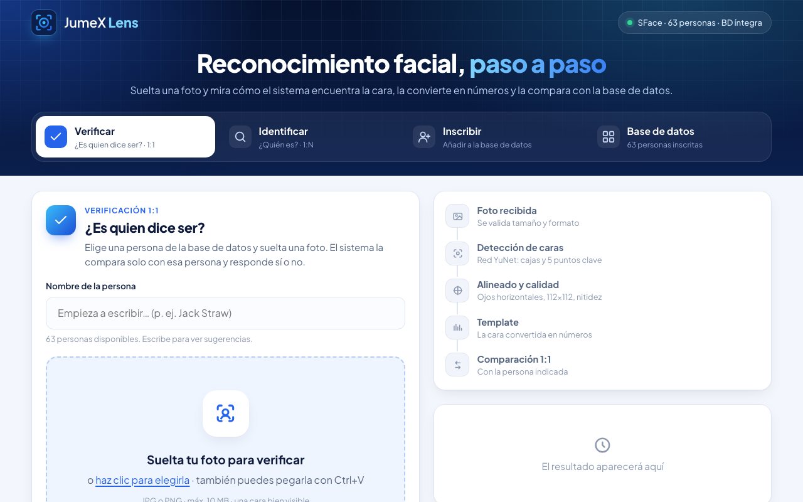
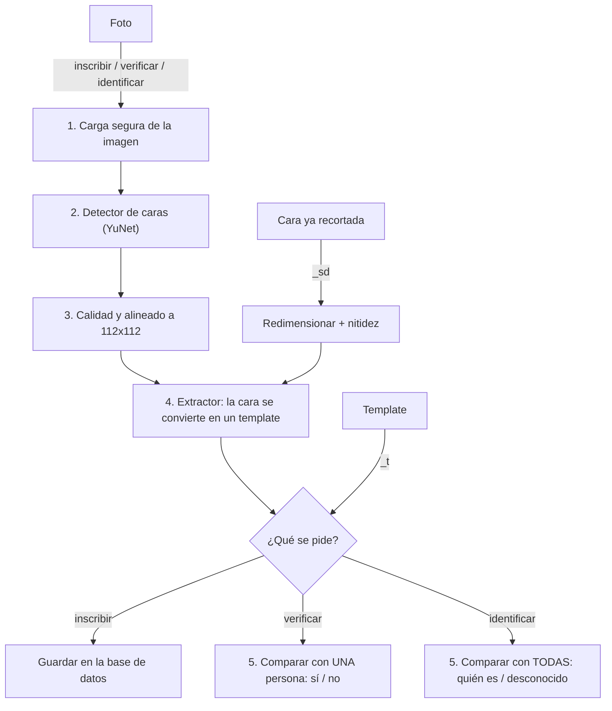

# JumeXBiometrics

Sistema de **reconocimiento facial** en Python para la práctica de *Sistemas
Biométricos* (Grado en Ciberseguridad e IA, Universidad de Málaga). El
enunciado está en [`Prácticas.pdf`](Pra%CC%81cticas.pdf).

Dada una foto, el sistema **encuentra la cara, la convierte en una lista de
números (el *template*) y la compara con las personas guardadas** en una base
de datos `.csv` protegida con firma criptográfica. Con eso permite **inscribir**
personas, **verificar** una identidad (¿es esta foto de Ana?) e **identificar**
a alguien (¿de quién es esta foto?). Se maneja desde la línea de comandos, desde
Python o desde una web, **JumeX Lens**.



> **Estado:** el sistema (detector, extractores, base de datos, los 9 métodos, la
> CLI y la web) está terminado y probado (todos los tests pasan, también dentro del
> Docker), y el modelo de amenazas está en [`THREAT_MODEL.md`](THREAT_MODEL.md). La
> técnica asignada, **ArcFace**, es el extractor principal, con los umbrales
> calibrados sobre LFW (`scripts/evaluar.py`). La evaluación propia, con curvas
> DET/ROC/CMC, calibración y test separados y fotos nuevas de Lionel Messi, está en
> [`docs/EVALUACION.md`](docs/EVALUACION.md). **Falta** la evaluación del grupo rival. Los detalles,
> sin maquillar, están en [Estado del proyecto](#estado-del-proyecto-y-trabajo-pendiente).

## Levantar la web en un comando

Para cualquier grupo, en cualquier ordenador. Solo hace falta **Docker** (Docker
Desktop en Windows/macOS, u OrbStack en macOS) y **git**.

```bash
git clone -b main https://github.com/Viiktor08/JumeXBiometrics.git
cd JumeXBiometrics
docker compose up --build
```

La primera vez tarda unos minutos (descarga la imagen base y los modelos, unos
300 MB, e inscribe a las personas del Dataset). Cuando termina, en la consola sale
el **PIN de administrador** (para inscribir, borrar y ver la base de datos).

- **En tu ordenador:** <http://localhost:8000>. Por defecto la web **no** se publica
  en internet.
- **Para que entren otros** (por ejemplo en clase), con una URL pública
  `https://….trycloudflare.com` que funciona desde cualquier red sin abrir puertos:

  ```bash
  docker compose --profile publico up --build web-publico
  ```

  Sale en el log (`docker compose logs web-publico`). Cualquiera con la URL puede
  verificar e identificar: levántala solo cuando haga falta.
- **La CLI, con la misma base de datos** (los 9 métodos; ver [Uso](#uso)):

  ```bash
  docker compose exec web python -m biometria bd
  docker compose exec web python -m biometria verificar --id "Keanu Reeves" --foto Dataset/keanu_reeves_2021.png
  ```

- **Para pararlo:** `Ctrl+C`. Para dejarlo en segundo plano: `docker compose up --build -d`
  y se para con `docker compose down`.

**Qué conviene saber:**

| | |
|---|---|
| **Dónde corre** | En el ordenador que lanza el comando. Si se apaga, se duerme o pierde internet, la web y su URL dejan de funcionar. Cada grupo que lo levante tiene su propia web y su propia URL. |
| **La URL pública** | Solo con `--profile publico`. Cambia en cada arranque: tras reiniciar hay que volver a compartirla. |
| **Claves y PIN** | No viaja ningún secreto con el repositorio. La primera vez se genera una **clave maestra aleatoria** en `~/.jumex/clave_lens.key` de tu ordenador (cifra y firma la base de datos), y el **PIN de administrador** se genera aleatorio en **cada arranque**. Para un PIN fijo: `cp env.ejemplo .env` y escríbelo ahí (8+ caracteres; `.env` no se sube a git). |
| **Qué puede hacer cada uno** | Con la URL, cualquiera puede **verificar** e **identificar** (subiendo una foto o con la cámara). **Inscribir, borrar o ver la base de datos** exige el PIN. |
| **Base de datos** | Se crea sola la primera vez en `data/lens/` con las fotos de `Dataset/` y se reutiliza en los siguientes arranques. Para empezar de cero: `docker compose down`, borrar `data/lens/` y `~/.jumex/clave_lens.key` y `~/.jumex/sello-*.json`, y volver a lanzar. |
| **Puerto ocupado** | Si el 8000 está en uso: `PUERTO=8080 docker compose up --build` (en PowerShell: `$env:PUERTO=8080; docker compose up --build`). |
| **Linux** | Si da `Permission denied` en `data/`: `sudo chown -R 1000:1000 data` (el contenedor no corre como root). |
| **`additional privileges requested`** | Pasa en macOS si el repositorio está dentro de una carpeta sincronizada (OneDrive, iCloud…): Docker Compose pide permiso para leer esa ruta al construir. Se arregla con `BUILDX_BAKE_ENTITLEMENTS_FS=0 docker compose up --build` (en PowerShell: `$env:BUILDX_BAKE_ENTITLEMENTS_FS=0; docker compose up --build`), o clonando el repositorio en una carpeta normal. |
| **BD creada antes del 24/11/2026** | Tiene 49 personas (sin Lionel Messi): la BD solo se crea si no existe. Para añadirlo sin empezar de cero: `docker compose exec web python -m biometria inscribir --id "Lionel Messi" --foto Dataset/lionel_messi_2022.jpg`. |

## Índice

- [Levantar la web en un comando](#levantar-la-web-en-un-comando)
- [Qué ofrece](#qué-ofrece)
- [Puesta en marcha](#puesta-en-marcha)
- [Cómo funciona por dentro](#cómo-funciona-por-dentro)
  - [Visión general](#visión-general)
  - [Paso 1: cargar la imagen](#paso-1-cargar-la-imagen)
  - [Paso 2: encontrar la cara](#paso-2-encontrar-la-cara)
  - [Paso 3: control de calidad y alineado](#paso-3-control-de-calidad-y-alineado)
  - [Paso 4: convertir la cara en un template](#paso-4-convertir-la-cara-en-un-template)
  - [Paso 5: comparar](#paso-5-comparar)
  - [La base de datos](#la-base-de-datos)
  - [Inscribir, verificar e identificar](#inscribir-verificar-e-identificar)
  - [Las variantes sd y t](#las-variantes-sd-y-t)
- [Los modelos que utiliza](#los-modelos-que-utiliza)
- [Cuánto acierta](#cuánto-acierta)
- [Uso](#uso)
  - [Línea de comandos](#línea-de-comandos)
  - [Desde Python](#desde-python)
  - [Scripts y herramientas](#scripts-y-herramientas)
- [JumeX Lens (la web)](#jumex-lens-la-web)
- [Configuración](#configuración)
- [Seguridad](#seguridad)
- [Estructura del repositorio](#estructura-del-repositorio)
- [Tests](#tests)
- [Estado del proyecto y trabajo pendiente](#estado-del-proyecto-y-trabajo-pendiente)
- [Decisiones de diseño](#decisiones-de-diseño)
- [Problemas frecuentes](#problemas-frecuentes)
- [Glosario](#glosario)
- [Referencias](#referencias)

> **¿Eres nuevo en el proyecto?** Empieza por [`GUIA_DEL_PROYECTO.md`](GUIA_DEL_PROYECTO.md): qué hace, cómo se lanza y cómo está protegido, explicado de principio a fin.

---

## Qué ofrece

El sistema responde a tres preguntas:

| Operación | Pregunta | Resultado |
|---|---|---|
| **Inscribir** | "Esta es Ana: guárdala." | Añade una muestra de Ana a la base de datos |
| **Verificar** (1:1) | "¿Es esta foto de Ana?" | Sí o no, con una puntuación |
| **Identificar** (1:N) | "¿De quién es esta foto?" | Un nombre, o "desconocido" |

Y lo hace de tres formas, según lo que se le dé:

| Entrada | Métodos | Qué se salta |
|---|---|---|
| Una **foto** | `inscribir`, `verificar`, `identificar` | Nada: pipeline completo |
| Una **cara ya recortada** | `inscribir_sd`, `verificar_sd`, `identificar_sd` | El detector (*sin detector*) |
| Un **template** | `inscribir_t`, `verificar_t`, `identificar_t` | El detector y el extractor |

Son los **9 métodos que pide el enunciado**. Además:

- **Línea de comandos** con salida JSON (también dentro de Docker): pensada para que el grupo rival pueda ejecutar y atacar el sistema.
- **API en Python** (`SistemaBiometrico`).
- **ArcFace** (la técnica asignada, red ResNet-50) como extractor principal, y otros dos intercambiables con una línea de configuración para comparar: SFace (red neuronal más ligera) y LBP (técnica clásica de textura).
- **Base de datos en CSV** con firma HMAC por fila, cifrado opcional de los templates y escritura atómica.
- **JumeX Lens**: web para verificar, identificar (incluso a varias personas en una foto), inscribir y editar la base de datos, con la animación de cada paso del pipeline. Las fotos se pueden subir o **hacer en el momento con la cámara**.
- **Demo de cámara** en directo y varios scripts para revisar el detector y comparar caras.
- **Dockerfile** y **270 tests**.

---

## Puesta en marcha

### En local (lo más cómodo)

Requisitos: **Python 3.11 o superior** (el Docker usa 3.11; se ha desarrollado con 3.14).

```bash
python3 -m venv .venv && source .venv/bin/activate   # en Windows: .venv\Scripts\activate
pip install -r requirements-dev.txt
python scripts/descargar_modelos.py                   # baja los modelos y verifica su SHA256
python -m biometria                                   # comprueba que todo está en su sitio
pytest -q                                             # 270 tests
```

> Si el repo está en OneDrive o Dropbox, crea el entorno virtual **fuera** de la
> carpeta sincronizada (`python3 -m venv ~/.venvs/jumex`) para evitar conflictos.

### Con Docker

**La web:** `docker compose up --build` (ver
[Levantar la web en un comando](#levantar-la-web-en-un-comando)).

**La CLI** (la misma imagen y la **misma BD** que la web, `data/lens/bd.csv`; sin
`--config`):

```bash
docker compose exec web python -m biometria bd                                  # con la web levantada
docker compose exec web python -m biometria identificar --foto Dataset/adele_2016.jpg
docker compose run --rm --entrypoint python web -m biometria bd                 # sin levantar la web
docker compose --profile pruebas run --rm pruebas                              # tests (imagen aparte con pytest)
```

`data/` se monta como volumen: ahí viven `lens/bd.csv` y las fotos de la galería.
`Dataset/` también se monta (solo lectura), así que sus fotos se pueden usar en la
CLI con la ruta `Dataset/…`; cualquier otra foto tiene que estar dentro de `data/`
para que el contenedor la vea. Los modelos se descargan y se
verifican durante el *build*, no están en el repositorio. La cámara de la demo
`biometria.camara` no se ve desde Docker en macOS (en la web, el botón de la
cámara sí funciona porque la usa el navegador).

### Para el equipo: clonar y empezar

```bash
git clone -b main https://github.com/Viiktor08/JumeXBiometrics.git
cd JumeXBiometrics
python3 -m venv ~/.venvs/jumex && source ~/.venvs/jumex/bin/activate
pip install -r requirements-dev.txt
python scripts/descargar_modelos.py          # ~290 MB la primera vez (ArcFace); verifica SHA256
pytest -q                                    # 270 tests
```

- El repositorio es **público**: se clona sin pedir acceso. Para subir cambios hay que ser colaborador (Settings → Collaborators).
- **No clones dentro de OneDrive, Dropbox o iCloud.** Esos servicios dejan ficheros
  de `.git` solo en la nube y git empieza a dar `Operation timed out`. Usa una
  carpeta normal (p. ej. `~/dev`). El entorno virtual, también fuera.
- **`Dataset/` (las 49 fotos del docente y la de Lionel Messi, la persona elegida por
  el equipo) sí está en el repositorio**, para que
  `docker compose up` cree la BD solo. Las claves, las bases de datos, los modelos y
  cualquier otra foto están en el `.gitignore`. Ojo: el repositorio es público, así
  que **cualquiera** tiene la foto exacta con la que se inscribió cada persona (ver
  [`THREAT_MODEL.md`](THREAT_MODEL.md), riesgos aceptados). Para crear la BD sin Docker:

```bash
python scripts/preparar_dataset.py Dataset                          # crea data/dataset_ids.csv
python scripts/inscribir_csv.py data/dataset_ids.csv                # BD en data/lens/ (config.yaml)
python -m biometria.web --admin-pass TU_PIN_LARGO                   # http://127.0.0.1:8000
```

- La **clave** de cada BD se crea sola en `~/.jumex/` (fuera del repo). Si teníais
  una BD de antes con la clave en `data/`, pasadla con
  `python scripts/proteger_bd.py --config config_lens.yaml --clave-antigua data/lens/clave_hmac.key`
  (mueve la clave, cifra la BD y crea el sello).

- Trabajad en **ramas** (`git switch -c mi-cambio`) y subid con `git push -u origin
  mi-cambio`; no hagáis `push --force` sobre ramas compartidas.
- Antes de subir, `git status` no debe mostrar `data/`, `Dataset/`, `models/`,
  ficheros `.key`, `.csv` ni comprimidos. Si aparece alguno, **no lo añadáis**.

### Probarlo en 5 minutos

Con Docker, la BD de la entrega (las 50 personas de `Dataset/`) se crea sola:

```bash
docker compose up --build -d                                            # web en http://localhost:8000
docker compose exec web python -m biometria bd                          # las 50 personas y sus ids
docker compose exec web python -m biometria verificar --id "lionel messi" --foto Dataset/lionel_messi_2022.jpg
# {"operacion": "verificar", "id": "Lionel Messi", "aceptado": true, "puntuacion": 1.0, "umbral": 0.35, "fiable": null}
docker compose exec web python -m biometria identificar --foto Dataset/adele_2016.jpg
```

> **No inscribas otras personas (por ejemplo, de LFW) en `data/lens/`**: es la BD de
> la entrega y debe tener exactamente las 50 personas de `Dataset/`. Para medir el
> sistema con muchas caras está `scripts/evaluar.py`, que no toca ninguna BD.

---

## Cómo funciona por dentro

### Visión general

Todo el sistema gira en torno a una idea: **comparar números, no fotos**.
Una foto se transforma en un **template** (un vector de números que resume los
rasgos de la cara). Lo único que se guarda en la base de datos son templates,
nunca fotos, y reconocer a alguien consiste en comparar el template de la foto
nueva con los guardados.



**Ejemplo real de lo que ocurre al verificar** (una foto de 250×250 píxeles,
extractor ArcFace, umbral 35 %):

| Paso | Qué pasa | Resultado |
|---|---|---|
| Carga | Se valida el fichero y se decodifica | imagen 250×250 |
| Detección | YuNet busca caras | 1 cara, confianza 92 % |
| Calidad y alineado | Se comprueba tamaño y nitidez; se gira y recorta | cara de 112×112, nitidez 128 ✓ |
| Extractor | ArcFace convierte la cara en números | template de 512 valores |
| Comparación | Se compara con los templates guardados de "Jack Straw" | similitud 71 % |
| Decisión | 71 % ≥ 35 % (umbral) | **aceptado** |

Con otra persona cualquiera la similitud habría salido cerca del 0 %: con
ArcFace, dos desconocidos puntúan de media un 2,6 %.

### Paso 1: cargar la imagen

Toda imagen que entra al sistema (desde un fichero, desde bytes recibidos por
red o desde un array de numpy) pasa por **un único punto**,
`biometria/imagen.py`, que aplica los mismos límites siempre:

- Tamaño del fichero: máximo **10 MiB** (`limites.max_bytes_imagen`).
- Tamaño en píxeles: máximo **25 Mpx** (`limites.max_pixeles`). Además OpenCV
  rechaza por sí mismo, antes de decodificar, lo que supere los **50 Mpx**: es la
  defensa contra las "bombas de descompresión" (un PNG de pocos KB que ocupa
  gigabytes al abrirse).
- Lado mínimo de **16 px**.
- La orientación EXIF se aplica (las fotos de móvil giradas se enderezan).
- El resultado siempre es una imagen **BGR de 8 bits** (el formato de OpenCV).

Si algo falla, se lanza un error con código estable (`imagen_invalida`,
`imagen_demasiado_grande`) y el sistema no sigue.

### Paso 2: encontrar la cara

El detector es **YuNet** (red neuronal pequeña incluida en OpenCV,
`cv2.FaceDetectorYN`). Para cada cara devuelve su recuadro, **5 puntos clave**
(ojo izquierdo, ojo derecho, punta de la nariz y las dos comisuras de la boca) y
una **confianza** entre 0 y 1. Se aceptan las caras con confianza ≥ **0,8**.

Detalles que importan:

- **Detección multiescala.** YuNet pierde las caras que ocupan más de un ~40 %
  del ancho de la imagen (un retrato de primer plano). Por eso la imagen se
  analiza a tres tamaños (lado mayor de 1280, 640 y 320 px) y los resultados se
  fusionan: si dos detecciones se solapan más de un 40 % (IoU), son la misma cara
  y se queda la de mayor confianza. Las coordenadas siempre se devuelven en la
  imagen original, y la cara se recorta de la original a resolución completa.
- **Varias caras en la foto.** Según `detector.varias_caras`: `error` (por
  defecto en `config.yaml`) rechaza la foto con el error `varias_caras`, para no
  inscribir o verificar a la persona equivocada; `mayor` se queda con la cara más
  grande. Si no hay ninguna, error `sin_cara`.

### Paso 3: control de calidad y alineado

Antes de extraer nada se comprueba que la cara sirve:

| Control | Cómo se mide | Umbral (`config.yaml`) | Error |
|---|---|---|---|
| **Tamaño** | Lado menor del recuadro, en la imagen original | ≥ 60 px | `cara_pequena` |
| **Nitidez** | *Varianza del Laplaciano* de la cara ya alineada: una cara nítida tiene bordes marcados (valores altos); una borrosa, no | ≥ 50 | `imagen_borrosa` |

Después se **alinea**: con los 5 puntos clave se calcula la transformación
(rotación + escala + traslación) que lleva los ojos, la nariz y la boca a unas
posiciones fijas, y se recorta una cara de **112×112 píxeles**. Así todas las
caras llegan al extractor con los ojos horizontales y a la misma altura,
independientemente de cómo estuviera hecha la foto. Se usa la plantilla estándar
de ArcFace/InsightFace, de modo que el mismo recorte sirve para cualquier
extractor.

### Paso 4: convertir la cara en un template

El **extractor** transforma la cara alineada en un template. Todos cumplen la
misma interfaz (`biometria/extractores/base.py`): `extraer` (cara → template),
`comparar` (dos templates → similitud en [0, 1]) y `validar_template`
(comprueba que unos números recibidos de fuera son un template válido). Gracias
a eso, **cambiar de técnica es añadir un fichero y cambiar una línea de
`config.yaml`**; nada más se toca.

Hay tres extractores. **ArcFace es el que usa el sistema**; los otros dos se
conservan para compararlos con él.

**ArcFace** (`extractor.nombre: arcface`) — **la técnica asignada**. ArcFace
(Deng et al., 2019) es una forma de *entrenar* una red de reconocimiento facial:
cada persona del entrenamiento tiene un vector "centro" en una esfera y la red
aprende a llevar sus caras hacia él, pero con un **margen angular** extra
(`cos(θ + m)`, m = 0,5 rad). Así no basta con que la cara caiga del lado bueno:
tiene que quedar claramente separada de cualquier otra persona. El resultado
son vectores muy juntos para la misma persona y casi perpendiculares entre
personas distintas.
1. La cara alineada de 112×112 se pasa a RGB y se normaliza: `(píxel − 127,5) / 127,5`.
2. Una **ResNet-50** entrenada con ArcFace sobre WebFace600K (~600 000
   personas; modelo `w600k_r50` de InsightFace) la convierte en **512 números**.
3. Se hace lo mismo con la cara **volteada** y se suman los dos vectores
   (*test-time augmentation*): compensa pequeñas asimetrías de luz o pose.
4. El vector se normaliza para que mida 1.

Se ejecuta con el módulo `cv2.dnn` de OpenCV (unos 35 ms por cara en un
portátil), sin PyTorch ni onnxruntime.

**SFace** (`extractor.nombre: sface`) — red neuronal más ligera de OpenCV Zoo
(128 números). Fue la referencia antes de tener asignada la técnica.

**LBP** (*Local Binary Patterns*, `extractor.nombre: lbp`) — técnica clásica
basada en la textura de la cara. Sirve de línea base.
1. Se pasa la cara a gris.
2. Cada píxel se compara con sus 8 vecinos: los que son más claros o iguales dan
   un 1, los demás un 0. Los 8 resultados forman un número de 8 bits (el
   *código LBP*) que describe la micro-textura de ese punto (borde, esquina,
   zona plana…).
3. Los códigos se agrupan en 59 clases ("patrones uniformes").
4. La cara se divide en una rejilla de 7×7 = 49 celdas y de cada celda se
   calcula un **histograma** de esas 59 clases.
5. Los 49 histogramas, normalizados, se concatenan: **2891 números** (59 × 49).

### Paso 5: comparar

Cada extractor sabe medir cuánto se parecen dos templates, y **siempre devuelve
una puntuación entre 0 y 1, donde 1 significa idénticos**. Así los umbrales
significan lo mismo con cualquier técnica.

- **ArcFace: similitud coseno** entre los vectores (como miden 1, es el
  producto escalar), **recortada a 0**: `max(coseno, 0)`. Un coseno negativo solo
  significa "nada en común", así que un desconocido sale cerca del 0 % en vez
  del 50 % que daría `(coseno + 1)/2`.
- SFace: similitud coseno, convertida con `(coseno + 1)/2`.
- LBP: distancia chi-cuadrado entre histogramas, convertida con `1 − χ²/2`.

> Por eso **los umbrales dependen del extractor**: con SFace dos desconocidos
> puntuaban de media un 54 % y con ArcFace un 2,6 %. Al cambiar de extractor hay
> que recalibrarlos con `scripts/evaluar.py`.

Si una persona tiene varias muestras guardadas, su puntuación es la **máxima**
entre todas (o la **media**, con `bd.agregacion: media`).

### La base de datos

Los templates se guardan en un **CSV** (`data/lens/bd.csv` por defecto), **una fila
por muestra**; una persona puede tener varias:

```
id,template,hmac
Jack Straw,f32:BS+nOAAAAAAAAAAAAAAAAAUvJzkAAAAA...,4c1f9e07a3...
Jack Straw,f32:AAAgPwAAQD8AAAAAAAAAAAAAAAAAAAAA...,b72e04d19c...
Allyson Felix,f32:AADAPgAAAD8AAAAAAAAAAAAAAAAAAAAA...,51d9aa6e20...
```

| Columna | Contenido |
|---|---|
| `id` | El nombre de la persona (validado y normalizado, ver abajo) |
| `template` | `f32:` + los números del template en base64 (float32 little-endian). Con el cifrado activado: `gcm:` + base64 del template cifrado con AES-256-GCM |
| `hmac` | Firma HMAC-SHA256 de la fila |

**Cómo se protege.** El atacante que puede escribir en el CSV no debería poder
colar a nadie ni borrar a nadie sin que se note:

- **Una firma por fila** que cubre: el `id`, el `template`, **la posición de la
  fila y el número total de filas**. Por eso detecta no solo que se modifique una
  fila, sino también que se **borre, duplique o reordene**, o que se copie el
  template de una persona a otra. Cualquier cambio da el error `integridad_bd`.
- **Se verifica antes de interpretar nada:** cada vez que se usa la base de datos
  se lee el fichero entero y se comprueban todas las firmas *antes* de mirar el
  contenido de las filas. Nunca se vuelve a firmar algo que no pasó la
  verificación, así que una BD manipulada no puede "blanquearse" inscribiendo a
  alguien encima.
- **Escritura atómica:** se escribe en un fichero temporal, se fuerza a disco y se
  renombra. Un fallo a mitad no deja un CSV a medias.
- **La clave** viene de la variable de entorno `BIOMETRIA_HMAC_KEY` (mínimo 32
  caracteres) o, si no existe, del fichero `bd.ruta_clave`: **`~/.jumex/clave_lens.key`**
  (la misma para la CLI, el Docker y la web), **fuera de `data/` y del
  repositorio**, para que quien pueda leer o escribir la BD no tenga también la
  clave. Se genera sola la primera vez que se inscribe a alguien (64 caracteres
  aleatorios, permisos `600`). De esa clave maestra se derivan, con HKDF, **cuatro
  claves independientes**: firmas de la BD, cifrado, firma de templates y sello
  anti-rollback. **Si se pierde la clave, la base de datos no se puede verificar**
  y hay que volver a inscribir.
- **Cifrado** (`bd.cifrar_templates: true`, activado): los templates se cifran con
  AES-256-GCM; el `id` va como dato asociado, de modo que un template cifrado no
  se puede mover a otra persona. Cada fila dice con su prefijo `f32:`/`gcm:` cómo
  leerla; `scripts/proteger_bd.py` cifra una BD que estaba en claro.
- **Sello anti-rollback** (`bd.anti_rollback: true`): junto a la clave se guarda el
  SHA-256 firmado del último CSV escrito. Volver a una copia antigua o borrar el
  CSV da `integridad_bd`.
- **Bloqueo de fichero** (`flock`): dos procesos que escriben a la vez no se pisan.
- **Validación al leer:** cada template se comprueba con su extractor
  (dimensión, valores finitos, rangos). Una BD creada con otro extractor se
  rechaza con un mensaje claro, en vez de dar puntuaciones absurdas.

**Los identificadores.** Deben empezar por una letra o un número y solo pueden
contener letras (con acentos y ñ), números, espacios y `. - _ '`, hasta 100
caracteres. Empezar por letra o número evita la inyección de fórmulas al abrir el
CSV con Excel (`=`, `+`, `-`, `@`). Se normalizan a Unicode NFC, de modo que
"José" escrito de dos formas distintas es la misma persona.

**Al buscar un id no se distinguen mayúsculas, tildes ni espacios repetidos**
(`bd.clave_busqueda`): `verificar --id "lionel messi"` o `--id "Nicolás Maduro"`
encuentran a `Lionel Messi` y `Nicolas Maduro`, y la respuesta devuelve el id tal
como está inscrito. El id guardado (y su HMAC) no cambia. Inscribir con otra forma
del nombre añade la muestra a esa persona, no crea otra, y el límite de intentos de
`_t` es el mismo para todas las formas. Una errata de letra (`Lionel Mesi`) sigue
sin encontrarse.

**Otros límites:** como máximo **10 muestras por persona**
(`limites.max_muestras_por_id`).

**Operaciones disponibles** (`biometria/bd.py`): inscribir una muestra, consultar,
eliminar una persona, eliminar una muestra concreta y cambiar el nombre de una
persona. Cada muestra tiene una *clave estable* (los 16 primeros caracteres del
SHA-256 de su campo `template`), sin necesidad de otra columna; la web la usa
para asociar a cada muestra su foto.

**Qué NO protege** (ver [`THREAT_MODEL.md`](THREAT_MODEL.md), paso 6): quien
tenga la **clave** (o pueda escribir en `~/.jumex/`) puede firmar y cifrar lo que
quiera. En Windows no hay bloqueo de fichero.

### Inscribir, verificar e identificar

**Inscribir** (`id`, foto):
1. Se valida el `id`.
2. La foto pasa por el pipeline (pasos 1 a 4) y da un template.
3. Se añade como una **nueva muestra** de esa persona (se crea si es nueva), si no
   se supera el máximo de muestras. Si la persona ya existía, la muestra nueva tiene
   que parecerse a su **primera** muestra (`coherencia_muestra`, paso 1 del
   THREAT_MODEL).

Si la persona es **nueva** y su cara se parece al menos `cara_duplicada` (0,60) a
alguien ya inscrito, se rechaza con `cara_ya_inscrita`: la misma cara con otro nombre
rompería la identificación de la original. El mensaje no dice a quién se parece.

**Verificar** (`id`, foto) — 1:1:
1. Se comprueba que `id` está inscrito (antes de procesar la foto: un `id`
   inexistente responde rápido y con un error claro).
2. La foto da un template.
3. Se compara con las muestras de esa persona y se calcula su puntuación (máximo o
   media).
4. **Aceptado si la puntuación ≥ `umbrales.verificacion`**. Siempre se devuelve la
   puntuación, también cuando se rechaza.

**Identificar** (foto) — 1:N:
1. La foto da un template.
2. Se compara con **todas** las personas de la base de datos.
3. Se toma la de mayor puntuación (con empate, la primera alfabéticamente, para que
   el resultado sea determinista).
4. Si esa puntuación ≥ `umbrales.identificacion`, se devuelve esa persona; si no,
   **desconocido** (`id: null`). En ambos casos se informa de la mejor puntuación.

> El umbral de identificación suele ser algo más exigente que el de
> verificación: en 1:N se compara con todas las personas, así que cuantas más
> hay, más probable es una coincidencia falsa por casualidad.

### Las variantes sd y t

Existen porque el enunciado pide evaluar qué ocurre si **un atacante se salta
alguna parte del sistema**.

| Variante | Qué recibe | Qué hace | Qué se salta |
|---|---|---|---|
| `_sd` (*sin detector*) | Una foto que **ya es una cara recortada** | La redimensiona a 112×112 (**sin alinear**: no hay puntos clave), comprueba la nitidez y extrae el template | Detector y alineado |
| `_t` | Un **template** | Lo valida con el extractor (dimensión, valores finitos, rangos) y lo usa directamente | Detector y extractor (ni siquiera carga el modelo YuNet) |

Una decisión de interpretación: el enunciado dice que `verificar_t` e
`identificar_t` reciben "una foto", pero también que omiten el extractor, así que
se interpreta como una errata y reciben un **template**.

---

## Los modelos que utiliza

| Modelo | Para qué | Tamaño | Origen y licencia |
|---|---|---|---|
| **YuNet** `face_detection_yunet_2023mar.onnx` | Detectar caras y sus 5 puntos | 228 KB | [OpenCV Zoo](https://github.com/opencv/opencv_zoo/tree/main/models/face_detection_yunet) · MIT |
| **ArcFace** `arcface_w600k_r50.onnx` | **Extractor principal** (512 números) | 167 MB | `w600k_r50.onnx` del paquete `buffalo_l` de [InsightFace](https://github.com/deepinsight/insightface/tree/master/model_zoo) · uso no comercial / investigación |
| **SFace** `face_recognition_sface_2021dec.onnx` | Extractor para comparar (128 números) | 37 MB | [OpenCV Zoo](https://github.com/opencv/opencv_zoo/tree/main/models/face_recognition_sface) · Apache 2.0 |
| **LBP** | Extractor clásico de línea base (2891 números) | — (algoritmo, implementado en `biometria/extractores/lbp.py` con numpy) | Ahonen et al., 2006 |

- Los modelos **no están en el repositorio** (están en el `.gitignore`):
  `python scripts/descargar_modelos.py` los descarga a `models/` y **verifica su
  SHA256**, para que un modelo corrupto o sustituido no entre al sistema. Los hashes
  esperados están en ese script. ArcFace solo se publica dentro de un zip de
  ~290 MB (con otros modelos que no se usan): el script lo baja a un temporal,
  extrae `w600k_r50.onnx`, verifica su hash y borra el zip.
- Se usa el detector YuNet y no MTCNN porque viene integrado en OpenCV, pesa
  unos 230 KB, no necesita PyTorch ni TensorFlow y da los 5 puntos clave.
- Los tests usan la foto oficial de la astronauta Eileen Collins (NASA, dominio
  público, distribuida con scikit-image), que se descarga a `tests/.cache/` con
  verificación de hash.
- Para las pruebas con caras reales se usa **LFW** (*Labeled Faces in the Wild*,
  fotos de personas conocidas obtenidas de internet), descargado por
  `scripts/preparar_lfw.py` también con verificación de hash. Las fotos **no se
  suben al repositorio**.

---

## Cuánto acierta

La evaluación completa (LFW, la galería real, robustez y ataques, antes y después de
las defensas) está en [`docs/EVALUACION.md`](docs/EVALUACION.md).

Para entender los números:

- **FAR** (*False Accept Rate*): proporción de impostores a los que el sistema
  acepta por error. **FRR** (*False Reject Rate*): proporción de personas
  correctas a las que rechaza por error. Subir el umbral baja el FAR y sube el FRR.
- **EER** (*Equal Error Rate*): el punto en el que ambos coinciden. Cuanto más
  bajo, mejor sistema.
- **Rank-1**: en identificación, qué proporción de veces acierta la persona
  correcta como primera opción.

Se mide con [`scripts/evaluar.py`](scripts/evaluar.py), que es reproducible
(mismas personas con la misma semilla). Toma personas de LFW con al menos 2
fotos (hasta 4), compara **todos los pares** (genuinos = misma persona,
impostores = personas distintas) y simula la identificación: la primera foto
de cada persona hace de base de datos, el resto se identifican y personas con
una sola foto en LFW hacen de desconocidos.

```bash
python scripts/evaluar.py --personas 400 --fotos 4 --desconocidos 600 --semilla 11 --tabla
python scripts/evaluar.py --config config_lens.yaml ...    # con otra configuración
```

**ArcFace**, 392 personas · 1111 fotos · 1173 pares genuinos · 615 432 impostores:

| | ArcFace | SFace (antes) |
|---|---|---|
| Similitud media, misma persona | 0,67 | 0,83 |
| Similitud media, personas distintas | **0,03** | 0,54 |
| p99 de personas distintas | 0,15 | 0,65 |
| **EER** | **0,68 %** (umbral 0,158) | 1,60 % |
| **Rank-1** (identificar) | **99,2 %** | 98,4 % |
| Desconocidos confundidos con alguien | **0,17 %** | 4,3 % |

(SFace se midió con 200 personas: `--personas 200 --semilla 7`. ArcFace con
esas mismas 200 da EER 0,82 % y rank-1 99,2 %.)

Con ArcFace, según el umbral:

| Umbral | FAR | FRR |
|---|---|---|
| 0,15 | 0,93 % | 0,68 % |
| 0,20 | 0,13 % | 0,85 % |
| 0,25 | 0,017 % | 0,85 % |
| **0,30** (umbral de "parecido" de la web) | 0,0018 % | 0,85 % |
| **0,35** (verificación) | **0,0005 %** | **0,85 %** |
| **0,40** (identificación) | **0,0005 %** | **1,02 %** |
| 0,50 | 0,0003 % | 4,0 % |

**Cómo leer estos resultados, con honestidad:**
- **ArcFace separa muchísimo mejor que SFace**: no tanto porque acierte más la
  misma persona, sino porque **dos desconocidos dan casi 0** en vez del ~54 %.
  Por eso con SFace la web enseñaba "parecidos" al 65 % que no se parecían en nada.
- Los FAR por debajo del 0,001 % son **unos pocos pares** de 615 432, y alguno es
  probablemente un error de etiquetado de LFW (el impostor máximo, 0,91, tiene
  pinta de ser la misma persona con dos nombres). Con más datos pueden cambiar.
- Los umbrales se eligieron **sobre los mismos datos** con los que se miden, así
  que estas cifras son algo optimistas. Por eso se repitió **con calibración y test
  separados** (personas distintas): en test, EER 0,44 % y, con 0,35, FAR 0,0011 % y
  FRR 0,65 %. Además, **10 fotos nuevas de Messi** (2007–2022) se reconocen todas
  (0,57–0,75). Curvas y detalle en [`docs/EVALUACION.md`](docs/EVALUACION.md).
- LFW son fotos de internet con mucha variación de pose y luz. Con fotos de la
  cámara (frontales y bien iluminadas) las puntuaciones genuinas suelen ser más altas.
- LBP (EER ≈ 37 %, rank-1 11 %) distingue muy poco; queda solo como línea base.

---

## Uso

### Línea de comandos

```
python -m biometria [--config FICHERO] <comando> [opciones]
```

Sin `--config` se usa `config.yaml`, que apunta a la **misma base de datos que la
web y el Docker** (`data/lens/bd.csv`, con la clave `~/.jumex/clave_lens.key`).
`--config config_lens.yaml` sigue funcionando y da lo mismo.

| Comando | Qué hace |
|---|---|
| `inscribir --id ID --foto F` | Inscribe una muestra (pipeline completo) |
| `verificar --id ID --foto F` | 1:1: ¿es ID la persona de la foto? |
| `identificar --foto F` | 1:N: ¿quién es? (`null` si nadie supera el umbral) |
| `inscribir_sd` / `verificar_sd` / `identificar_sd` | Igual, con una **cara ya recortada** (sin detector) |
| `inscribir_t --id ID --template T` / `verificar_t` / `identificar_t --template T` | Con un **template** (sin detector ni extractor) |
| `extraer --foto F --salida T [--sin-detector]` | Guarda el template de una foto, para usarlo con los `_t` |
| `bd` | Verifica la integridad de la base de datos y lista a los inscritos (con sus ids exactos) y las protecciones activas |
| `sellar` | Acepta **a propósito** la BD actual y crea su sello anti-rollback (cuando falta el sello: primera vez desde otro equipo o ruta, o tras restaurar un respaldo). Verifica antes el HMAC de cada fila |
| `estado` (o sin comando) | Versiones y estado del entorno |

Cada comando imprime **una línea JSON** y devuelve un código de salida: `0` si la
operación se ha ejecutado (una verificación rechazada también da 0: mira
`aceptado`), `1` si hay un error controlado y `2` si faltan argumentos. Salidas
reales con el extractor ArcFace, de una prueba con personas de LFW inscritas en una
BD de pruebas (con la BD de la entrega, usa las fotos de `Dataset/` y los ids de
`python -m biometria bd`; las respuestas actuales añaden el campo `fiable`):

```bash
python -m biometria verificar --id "Jack Straw" --foto data/lfw/pruebas/inscritos/Jack_Straw_0002.jpg
# {"operacion": "verificar", "id": "Jack Straw", "aceptado": true, "puntuacion": 0.7147, "umbral": 0.35}

python -m biometria verificar --id "Jack Straw" --foto data/lfw/pruebas/inscritos/Marc_Grossman_0002.jpg
# {"operacion": "verificar", "id": "Jack Straw", "aceptado": false, "puntuacion": 0.0, "umbral": 0.35}

python -m biometria identificar --foto data/lfw/pruebas/inscritos/Allyson_Felix_0003.jpg
# {"operacion": "identificar", "identificado": true, "id": "Allyson Felix", "puntuacion": 0.5552, "umbral": 0.4}

python -m biometria identificar --foto data/lfw/pruebas/desconocidos/Colin_Powell_0002.jpg
# {"operacion": "identificar", "identificado": false, "id": null, "puntuacion": 0.1353, "umbral": 0.4}

python -m biometria verificar --id "Nadie" --foto data/fotos/ana.jpg
# {"error": "id_no_inscrito", "mensaje": "'Nadie' no está inscrito"}      (código de salida 1)

python -m biometria inscribir --id "Ana López" --foto data/fotos/ana.jpg
# {"operacion": "inscribir", "id": "Ana López", "muestras": 1}

python -m biometria extraer --foto data/fotos/ana.jpg --salida ana.npy
python -m biometria verificar_t --id "Ana López" --template ana.npy
```

Los **templates** de `--template` y `--salida` pueden ser `.npy` (float32; nunca
se cargan objetos con pickle), `.json` (lista de números) o un texto con el
formato de la base de datos (`f32:` + base64).

**Códigos de error** (siempre en `{"error": código, "mensaje": ...}`):

| Código | Significado |
|---|---|
| `imagen_invalida` | No existe, no es una imagen o está corrupta |
| `imagen_demasiado_grande` | Supera el límite de bytes o de píxeles |
| `sin_cara` | No se detectó ninguna cara |
| `varias_caras` | Hay más de una cara y `varias_caras: error` |
| `cara_pequena` | La cara mide menos de `tam_min_cara` píxeles |
| `imagen_borrosa` | La nitidez no llega a `umbral_borrosidad` |
| `template_invalido` | Dimensión, tipo o valores no válidos para el extractor |
| `id_invalido` | El nombre no cumple las reglas |
| `id_no_inscrito` | Esa persona no está en la base de datos |
| `muestra_no_encontrada` | Esa muestra no existe |
| `muestra_incoherente` | La muestra nueva no se parece a la primera de esa persona |
| `cara_ya_inscrita` | Se intenta crear una persona con una cara que ya está inscrita con otro nombre |
| `template_no_firmado` | Un `_t` recibe un template sin firma válida de este sistema |
| `demasiados_intentos` | Demasiadas comparaciones `_t` seguidas para el mismo id |
| `limite_muestras` | La persona ya tiene el máximo de muestras |
| `bd_corrupta` | El CSV no tiene el formato esperado |
| `integridad_bd` | Una firma HMAC no cuadra (el CSV fue modificado fuera del sistema), rollback, o falta el sello de una BD que existe (ver `sellar`) |
| `configuracion_invalida` | Valor fuera de rango o falta un fichero |

### Desde Python

```python
from biometria.sistema import SistemaBiometrico

sistema = SistemaBiometrico()                        # o SistemaBiometrico(cargar_config("otra.yaml"))
sistema.inscribir("Ana López", "data/fotos/ana.jpg") # la foto: ruta, bytes o array BGR de numpy
sistema.verificar("Ana López", "data/fotos/ana_2.jpg")
# ResultadoVerificacion(id='Ana López', aceptado=True, puntuacion=0.68, umbral=0.35)
sistema.identificar("data/fotos/quien.jpg")
# ResultadoIdentificacion(id='Ana López', puntuacion=0.68, umbral=0.4)

t = sistema.extraer("data/fotos/ana.jpg")            # el template (numpy float32)
sistema.verificar_t("Ana López", t)
sistema.ranking(t, 3)                                # las 3 personas más parecidas: [(id, puntuación), ...]
```

Los módulos sueltos también se pueden usar: `Detector` (`detectar`, `procesar`),
`crear_extractor` (`extraer`, `comparar`, `validar_template`) y `BaseDatos`
(`inscribir`, `templates_de`, `por_id`, `eliminar`, `eliminar_muestra`, `renombrar`).

### Scripts y herramientas

| Comando | Para qué sirve |
|---|---|
| `python scripts/descargar_modelos.py [--forzar]` | Descarga YuNet, ArcFace y SFace a `models/` y verifica su SHA256 |
| `python scripts/evaluar.py [--config C] [--personas N] [--fotos K] [--tabla]` | Evalúa el extractor con LFW: genuinos/impostores, EER, umbral para un FAR objetivo, tabla FAR/FRR, rank-1 y desconocidos aceptados |
| `python scripts/migrar_extractor.py [--config C] [--si]` | Al cambiar de extractor, rehace la BD de la web a partir de las fotos de su galería (con respaldo completo antes) |
| `python scripts/preparar_lfw.py [--personas N] [--semilla S]` | Saca N personas de LFW a `data/lfw/` (fotos y `personas.csv` con `id,foto`) |
| `python scripts/inscribir_csv.py FICHERO.csv [--config C]` | Inscribe en bloque a las personas de un CSV `id,foto` (y guarda su foto para la web) |
| `python scripts/probar_detector.py CARPETA [--anotadas] [--recursivo] [--salida S]` | Pasa el detector por una carpeta y guarda las caras recortadas, las fotos anotadas y un `resumen.csv` (confianza, tamaño, nitidez) para calibrar la calidad |
| `python scripts/comparar_caras.py FOTO1 FOTO2 ...` | Muestra la similitud entre las caras de varias fotos (una puntuación o una matriz) |
| `python -m biometria.camara [--umbral U]` | Detección en directo con la webcam: caras, confianza, puntos, resultado de la calidad y la cara alineada; con `s` guarda la foto, con `q` sale |
| `python -m biometria.web [--tunel]` | Arranca JumeX Lens (ver siguiente apartado) |
| `python scripts/arrancar_web.py [opciones de la web]` | Lo que ejecuta `docker compose up`: si no existe la BD de la web, la crea con las fotos de `Dataset/` (clave aleatoria nueva) y arranca la web |
| `python scripts/graficas.py [--personas N] [--desconocidos D] [--salida S]` | Evaluación para la memoria: reparte LFW en personas de calibración y de test, fija umbrales en una y mide en la otra; curvas DET, ROC, CMC (con distractores) y FPIR/FNIR, y las fotos nuevas de Messi de `fotos_prueba/messi/` contra la galería real. Deja PNG y `resultados.json` en `docs/graficas/` |
| `docker compose exec -T web python scripts/pruebas_revision.py` | Batería de ataques y medidas contra el sistema real (BD y clave temporales): foto exacta, robustez, `_sd`, firma de `_t`, hill-climbing, ataques a la BD, deriva con morphs, ids, entradas, CLI y duplicados. Resultados y análisis en [`docs/EVALUACION.md`](docs/EVALUACION.md) |

---

## JumeX Lens (la web)

Interfaz para **ver el sistema funcionando**: se suelta una foto (o se hace con
la cámara) y se enseña cada paso del pipeline, con animación de detección y de
escaneo. Usa [`config_lens.yaml`](config_lens.yaml), que tiene los mismos valores que
`config.yaml`: extractor **ArcFace** y la misma base de datos (`data/lens/`) que la CLI.

```bash
docker compose up --build                                   # lo más fácil: crea la BD con Dataset/ la primera vez
python scripts/arrancar_web.py                              # lo mismo sin Docker (tras descargar_modelos.py)
python -m biometria.web                                     # solo la web, con la BD que ya haya: http://127.0.0.1:8000
```

**Qué se puede hacer** (cuatro pestañas):

| Pestaña | Qué hace |
|---|---|
| **Verificar** | Eliges una persona (con sugerencias) y sueltas una foto: responde "Sí, es X" / "No, no es X" con las dos caras lado a lado, una barra de similitud con el umbral marcado y la explicación |
| **Identificar** | Responde "Esta persona es X" o "No está en la base de datos", con las personas que **de verdad** se le parecen (ver abajo). **Si la foto tiene varias personas, comprueba cada cara por separado** (hasta 12) y dice quién es cada una o que no la tiene guardada; las desconocidas tienen un botón "Inscribirla" |
| **Inscribir** | Escribes el nombre y sueltas una foto. Pide confirmación ("¿Es esta la cara de X?") antes de guardar |
| **Base de datos** | Las caras en cuadraditos con el nombre, un buscador y el estado de la integridad. Al pulsar una persona se abre su **ficha** |

**La ficha de una persona** permite ver todas sus fotos (una por muestra),
añadir otra (subiéndola o con la cámara), borrar una concreta, elegir la foto
principal, cambiar el nombre o eliminar a la persona.

**Hacer la foto con la cámara.** En la zona de la foto (y en la ficha, para
añadir muestras) hay un botón **"Hacer una foto con la cámara"**. Abre un visor
con un óvalo de guía; se hace la foto, se revisa ("Usar esta foto" / "Repetir")
y sigue el mismo camino que una foto subida. Detalles:
- El navegador pide permiso la primera vez. Solo funciona en `localhost` o con
  `https` (el túnel de Cloudflare lo es), porque los navegadores no dan la cámara
  a páginas `http` normales.
- La cámara se apaga en cuanto se cierra el visor. La foto se envía al servidor
  local para analizarla, como cualquier otra.
- Con la cámara frontal la imagen se ve y se guarda **en espejo**, como en el
  móvil. A ArcFace le da igual: también compara la cara volteada.
- Si hay varias cámaras (móvil), aparece "Cambiar de cámara".

**Los más parecidos.** Al identificar solo se listan como parecidas las personas
que superan `umbrales.parecido` (0,30). Por debajo, la similitud es la de dos
desconocidos cualesquiera y ordenarlas sería ordenar ruido: antes, con SFace,
salían personas al 65 % que no se parecían en nada. Si nadie llega, la web lo
dice ("Nadie más se le parece" o "Nadie se le parece: la más cercana solo llega
al 14 %") en vez de enseñar caras al azar.

**Si el detector no encuentra la cara o elige otra**, se puede **marcar a mano**:
arrastrando un recuadro sobre la foto o pulsando una de las caras detectadas. Se
vuelve a buscar la cara dentro del recuadro para alinearla con sus 5 puntos; si ni
así aparece, se usa el recuadro sin alinear y se avisa de que la comparación será
menos fiable.

**Las fotos de la galería** se guardan solo para mostrarlas
(`data/lens/caras/<persona>/<muestra>.jpg`): el sistema compara **siempre
templates**, nunca estas fotos. Los nombres de fichero son hashes, nunca texto
escrito por el usuario.

### API HTTP

El servidor (solo librería estándar de Python) expone una API JSON. Las fotos se
envían como **cuerpo binario** de la petición.

| Método y ruta | Qué hace |
|---|---|
| `GET /api/estado` | Extractor, umbrales (verificación, identificación y parecido), nº de personas e integridad de la BD |
| `GET /api/personas` | Lista de personas: `{id, muestras, foto}` |
| `GET /api/persona?id=` | Ficha: las muestras de una persona con su foto |
| `GET /api/caras/<persona>/<muestra>.jpg` | Foto de una muestra |
| `POST /api/analizar` | Solo el pipeline (no toca la BD): detecciones, cara alineada, template |
| `POST /api/verificar?id=` | Verifica contra esa persona |
| `POST /api/identificar` | Identifica (a todas las caras si hay varias). `candidatos` solo trae a quien supera `umbrales.parecido`; `puntuacion` es siempre la del mejor |
| `POST /api/inscribir?id=` | Inscribe una muestra |
| `POST /api/persona/principal?id=&clave=` | Elige la foto principal |
| `POST /api/persona/renombrar?id=&nuevo=` | Cambia el nombre |
| `DELETE /api/personas?id=` | Elimina a una persona |
| `DELETE /api/muestras?id=&clave=` | Elimina una muestra |

Los `POST` con foto admiten `&caja=x,y,ancho,alto` (píxeles de la foto) para marcar
la cara a mano. Las respuestas incluyen cada paso (`detecciones`, `cara_alineada`,
`nitidez`, `template`, `tiempos_ms`) y el `resultado` o un `error` con el mismo
código que la CLI.

### Roles: usuario y administrador

La web tiene **dos roles** (ver [`THREAT_MODEL.md`](THREAT_MODEL.md)):

- **Usuario** (por defecto, sin contraseña): puede **verificar** e
  **identificar**. Al identificar ve el nombre ("Es X" o "Desconocido") y el
  porcentaje, pero **no la foto guardada ni la lista de parecidos**. No inscribe,
  no borra y no ve la pestaña "Base de datos".
- **Administrador** (con **PIN**): además inscribe, edita, borra y ve toda la BD.

El PIN se fija con `--admin-pass`, la variable `BIOMETRIA_ADMIN_PASS`, o se
genera uno aleatorio que se imprime al arrancar. Desde la web se entra con la
**pastilla de arriba a la derecha**. El rol se comprueba en el **servidor** (no
solo ocultando botones): pedir un endpoint de admin sin sesión da `403
requiere_admin`.

```bash
python -m biometria.web --admin-pass TU_PIN      # PIN fijo (usa uno largo y no lo subas al repo)
BIOMETRIA_ADMIN_PASS=TU_PIN python -m biometria.web
```

### Seguridad de la web

- Solo escucha en **`127.0.0.1`**.
- **Roles usuario/admin** (arriba): lo que toca la base de datos exige sesión de
  administrador, comprobada en el servidor.
- Los `POST` y `DELETE` exigen la cabecera **`X-JumeX-Lens: 1`**: obliga al
  navegador a un permiso previo (*preflight*) que nunca se concede, y así otra web
  abierta en el navegador no puede usar la API (CSRF).
- La sesión de admin va en una cookie **`HttpOnly; SameSite=Strict`** (no accesible
  desde JavaScript), **caduca a las 2 h** y por el túnel lleva `Secure`; el PIN se
  compara en tiempo constante.
- **Fuerza bruta del PIN:** 5 fallos desde una IP en 15 min bloquean esa IP; 20
  fallos en total bloquean el login para todos. Con `--tunel` no arranca con un
  PIN débil (menos de 8 caracteres, común, repetido o secuencial).
- **Límite por IP:** 60 operaciones con foto por minuto (el admin no tiene límite);
  timeout de 20 s por conexión y como mucho 32 conexiones a la vez (*slowloris*).
- **Verificar no revela quién está inscrito:** a un usuario, un nombre que no
  existe le da un rechazo normal, no "no inscrito".
- **El usuario no recibe los valores del template ni cuánta gente hay inscrita**
  (solo la dimensión del template, para el dibujo del pipeline). El admin sí.
- **Cara marcada a mano:** si en el recuadro no se encuentran los puntos clave, se
  usa sin alinear, pero antes se comprueba que hay una cara (como en los `_sd`):
  un recuadro con ruido o con fondo da `sin_cara`.
- Rechaza peticiones cuyo **`Host`** no sea localhost (*DNS rebinding*).
- El tamaño de la foto se comprueba **antes de leer el cuerpo**; solo se sirven los
  ficheros de la carpeta `static/`; el navegador recibe una *Content-Security-Policy*
  restrictiva.
- `Permissions-Policy: camera=(self), microphone=(), geolocation=()`: solo la
  propia página puede pedir la cámara, y nadie el micrófono ni la ubicación.

### Publicarla en internet (Cloudflare Tunnel)

```bash
brew install cloudflared            # una vez
python -m biometria.web --tunel     # escribe la URL https://<algo>.trycloudflare.com
docker compose --profile publico up --build web-publico   # lo mismo, en Docker (cloudflared viene en la imagen)
```

El servidor **sigue en tu equipo** y Cloudflare reenvía las visitas (sobre HTTPS):
la web solo está online mientras el comando siga abierto y la URL cambia cada vez
que se arranca. Se acepta además el dominio `trycloudflare.com`. Quien tenga la URL
entra como **usuario** (solo verificar e identificar); para inscribir o ver la base
de datos hace falta el **PIN de administrador**. Aun así, no la publiques con fotos
de personas que no hayan dado su permiso.

---

## Configuración

Todo lo ajustable está en [`config.yaml`](config.yaml) (el que usan por defecto la
CLI y el Docker); [`config_lens.yaml`](config_lens.yaml), el de la web, tiene los
mismos valores. Se puede usar
otro con `--config FICHERO` o con la variable de entorno `BIOMETRIA_CONFIG`. Las
rutas relativas se resuelven respecto a la carpeta del fichero. Al cargarse, la
configuración se **valida**: un valor fuera de rango da un error claro
(`configuracion_invalida`) en vez de un fallo raro más adelante.

| Sección | Parámetro | Valor en `config.yaml` | Qué controla |
|---|---|---|---|
| `detector` | `modelo` | `models/face_detection_yunet_2023mar.onnx` | Modelo del detector |
| | `umbral_confianza` | 0,8 | Confianza mínima de YuNet para aceptar una cara |
| | `umbral_nms` | 0,3 | Supresión de detecciones solapadas |
| | `varias_caras` | `mayor` | `error` rechaza la foto; `mayor` usa la cara más grande (dos fotos del Dataset tienen varias caras) |
| `preprocesado` | `tam_cara` | `[112, 112]` | Tamaño de la cara alineada ([ancho, alto]) |
| `calidad` | `tam_min_cara` | 60 | Lado mínimo de la cara (px) |
| | `umbral_borrosidad` | 40 | Nitidez mínima (varianza del Laplaciano) |
| `extractor` | `nombre` | `arcface` | `arcface`, `sface` o `lbp` |
| | `parametros` | `modelo: models/arcface_w600k_r50.onnx, voltear: true` | Parámetros del extractor. ArcFace: `modelo`, `voltear` (sumar la cara volteada). SFace: `modelo`. LBP: `radio`, `puntos`, `rejilla` ([columnas, filas]) |
| `bd` | `ruta` | `data/lens/bd.csv` | Dónde se guarda la base de datos (la misma para CLI, Docker y web) |
| | `ruta_clave` | `~/.jumex/clave_lens.key` | Fichero de la clave (si no hay variable de entorno). Fuera de `data/` |
| | `cifrar_templates` | `true` | Cifrar los templates con AES-GCM |
| | `anti_rollback` | `true` | Sello junto a la clave: detecta volver a una BD antigua o borrarla |
| | `sello_estricto` | `true` | Si la BD existe pero falta su sello: error en vez de fiarse (`python -m biometria sellar` la acepta a propósito) |
| | `agregacion` | `max` | `max` o `media` de las muestras de una persona |
| `umbrales` | `verificacion` | 0,35 | Puntuación mínima para aceptar al verificar |
| | `identificacion` | 0,40 | Puntuación mínima para no devolver "desconocido" |
| | `parecido` | 0,30 | Solo para mostrar: la web no lista como "parecido" a quien quede por debajo. No interviene en ninguna decisión |
| `limites` | `max_bytes_imagen` | 10 MiB | Tamaño máximo del fichero de imagen |
| | `max_pixeles` | 25 Mpx | Tamaño máximo en píxeles |
| | `max_muestras_por_id` | 10 | Muestras máximas por persona |
| `defensa` | `coherencia_muestra` | 0,35 | Al añadir una muestra a alguien que ya existe, similitud mínima con su **primera** muestra (0 = desactivado). Contra el envenenamiento de la inscripción y la deriva con morphs |
| | `ancla_muestra` | 0,20 | Al verificar o identificar, las muestras extra solo cuentan si la foto se parece al menos esto a la **primera** muestra (0 = desactivado). Una muestra envenenada no sirve para colar a otro |
| | `cara_duplicada` | 0,60 | Al crear una persona **nueva**, si su cara se parece al menos esto a alguien inscrito: `cara_ya_inscrita` (0 = desactivado). Contra la misma cara con otro nombre |
| | `decimales_puntuacion_t` | 2 | Decimales a los que se redondea la puntuación que devuelven los `_t` (0 = sin redondeo). Contra el hill-climbing |
| | `max_intentos_t` | 50 | Máx. comparaciones `_t` por id en la ventana (0 = sin límite). Contra el hill-climbing |
| | `ventana_intentos_s` | 60 | Ventana del límite anterior, en segundos |
| | `exigir_firma_t` | `true` | Los `_t` **rechazan** templates sin firma válida de este sistema (`template_no_firmado`). `false` = solo avisan con `fiable` |
| | `margen_identificacion` | 0,10 | En identificar, ventaja mínima del 1.º sobre el 2.º; si no, desconocido (`ambiguo`). Contra gemelos y dobles |
| | `cara_en_sd` | `true` | Los `_sd` comprueban con YuNet que la imagen es una cara (sin alinear) |

**Variables de entorno:** `BIOMETRIA_CONFIG` (configuración), `BIOMETRIA_HMAC_KEY`
(clave de la BD) y `BIOMETRIA_ADMIN_PASS` (PIN de administrador de la web).

`config_lens.yaml` tiene los mismos valores (se mantiene para no romper los
comandos con `--config config_lens.yaml`). **Los umbrales están
calibrados con LFW** (ver [Cuánto acierta](#cuánto-acierta)); con las fotos de la
práctica, el impostor más parecido entre las 50 personas da 0,25, lejos de 0,35.
**Si se cambia de extractor hay que
recalibrarlos**: cada técnica puntúa en una escala distinta.

**Variables de entorno:** `BIOMETRIA_CONFIG` (fichero de configuración) y
`BIOMETRIA_HMAC_KEY` (clave de la base de datos; tiene prioridad sobre el fichero).

---

## Seguridad

El enunciado pide que cada grupo evalúe su sistema suponiendo que **un atacante se
salta alguna parte, lee la base de datos o incluso escribe en ella**. El análisis
completo, con cada defensa medida y probada con tests, está en
[**`THREAT_MODEL.md`**](THREAT_MODEL.md), que también recoge **lo que no se para**
(riesgos aceptados). Resumen:

| Amenaza | Qué hace el sistema |
|---|---|
| **Modifica o manipula `bd.csv`** (cambiar, copiar entre personas, borrar, duplicar o reordenar filas) | Lo detecta: firma HMAC por fila con su posición y el total → `integridad_bd`. No se puede inscribir encima de una BD manipulada |
| **Envenenar la inscripción** (añadir mi cara como muestra de la víctima, o llegar a ella con una cadena de morphs) | ✅ Se rechaza: la muestra nueva debe parecerse a la **primera** muestra de esa persona (`coherencia_muestra`) → `muestra_incoherente`; y las muestras extra no cuentan para quien no se parece a la primera (`ancla_muestra`) |
| **Cualquiera inscribe/borra/lee por la web** | ✅ Dos roles: usuario (verificar/identificar) y **admin con PIN**; la BD solo la ve y toca el admin |
| **Se salta el extractor** (`_t`) con un template fabricado o copiado de la BD | ✅ El sistema **firma** los templates que genera (`extraer` crea el `.sig`) y los `_t` **rechazan** los que no traen una firma válida → `template_no_firmado` |
| **Hill-climbing** (ajustar un template probándolo hasta colarlo) | ✅ Cada variación pierde la firma y se rechaza sin dar puntuación. El redondeo y el límite de intentos solo lo retrasan: sin firma, el ataque necesita unos cientos de consultas |
| **Gemelos y dobles** | ✅ Si el 1.º y el 2.º candidato están a menos de 0,10, desconocido (`ambiguo`). ⚠️ No sirve si el gemelo no está inscrito |
| **Lee `bd.csv`** | ✅ Templates cifrados con AES-256-GCM; la clave está fuera de `data/` |
| **Restaura una BD antigua o la borra** (aunque borre también el sello) | ✅ Sello anti-rollback junto a la clave → `integridad_bd`. Si falta el sello de una BD que existe, también error (`sello_estricto`); solo `python -m biometria sellar`, con la clave, la acepta |
| **Inscribe la cara de otra persona con un nombre nuevo** (para que su identificación salga "ambiguo") | ✅ Se rechaza: `cara_ya_inscrita` si se parece ≥ 0,60 a alguien inscrito |
| **Se salta el detector** (`_sd`, o la cara marcada a mano en la web) con algo que no es una cara | ✅ YuNet comprueba que hay una cara → `sin_cara` |
| **Fuerza bruta del PIN, saturar o enumerar la web** | ✅ Bloqueo de PIN, sesión que caduca, límites por IP, timeouts, verificar sin revelar inscritos |
| **Imágenes malintencionadas** | Límites de bytes y píxeles (doble), decodificación solo mediante OpenCV, nunca se cargan objetos con pickle |
| **Nombres malintencionados** | Validación estricta de ids (sin saltos de línea, sin fórmulas de Excel, normalizados) |
| **Foto de una foto, deepfake, máscara** | ⚠️ Sin detección de vivacidad: riesgo aceptado y documentado (paso 7) |
| **Usa la foto exacta de `Dataset/`** (está en el repositorio) | ⚠️ Riesgo aceptado: se verifica con puntuación 1 |
| **El rival ejecuta el sistema en su ordenador** | ⚠️ Tiene la clave: las defensas criptográficas no le afectan. Ver "Dos escenarios" en `THREAT_MODEL.md` |

Las contramedidas están en las secciones `bd:` y `defensa:` de la configuración y
**se pueden desactivar** para medir el sistema sin ellas. `python -m biometria bd`
enseña cuáles están activas, y `scripts/medir_defensas.py` mide su coste en LFW.

---

## Estructura del repositorio

```
├── biometria/                    paquete principal
│   ├── __init__.py               versión y límite duro de píxeles (hay que importarlo antes que cv2)
│   ├── __main__.py               punto de entrada: python -m biometria
│   ├── cli.py                    línea de comandos (salida JSON)
│   ├── sistema.py                SistemaBiometrico: los 9 métodos
│   ├── imagen.py                 carga segura de imágenes (límites de bytes y píxeles)
│   ├── detector.py               YuNet multiescala + calidad + alineado
│   ├── extractores/
│   │   ├── base.py               interfaz común: extraer, comparar, validar_template
│   │   ├── arcface.py            ArcFace ResNet-50 de InsightFace (el asignado)
│   │   ├── sface.py              SFace de OpenCV Zoo (para comparar)
│   │   └── lbp.py                LBP uniforme por rejilla (línea base)
│   ├── bd.py                     base de datos CSV con HMAC, cifrado opcional y edición
│   ├── config.py                 carga y validación de la configuración
│   ├── errores.py                excepciones con código estable
│   ├── camara.py                 demo en directo con la webcam
│   └── web/                      JumeX Lens
│       ├── servidor.py           servidor HTTP y API JSON
│       ├── analisis.py           pipeline paso a paso, varias caras, galería de fotos
│       └── static/               interfaz: index.html, estilos.css, app.js, logo.svg
├── scripts/                      herramientas (ver "Scripts y herramientas")
├── tests/                        270 tests con pytest
├── docs/                         capturas, EVALUACION.md y graficas/ (curvas y resultados.json)
├── Dataset/                      las 49 fotos del docente + la de Messi (lo que se inscribe)
├── fotos_prueba/messi/           fotos nuevas de Messi solo para evaluar (nunca se inscriben), con CREDITOS.md
├── data/                         (fuera de git) fotos, bases de datos, claves
├── models/                       (fuera de git) modelos descargados
├── config.yaml                   configuración por defecto (ArcFace)
├── config_lens.yaml              igual que config.yaml (se mantiene por compatibilidad)
├── Dockerfile
└── requirements*.txt             dependencias con versiones fijadas
```

---

## Tests

`pytest -q` ejecuta **270 tests** en unos 30-40 segundos (también dentro del Docker). Cubren:

| Fichero | Qué comprueba |
|---|---|
| `test_imagen.py` | Carga segura: formatos, límites, imágenes corruptas |
| `test_config.py` | Validación de la configuración (incluido el umbral de parecido) |
| `test_detector.py` | Detección, caras muy grandes, calidad, alineado, imágenes reescaladas |
| `test_arcface.py` | ArcFace: template de 512 con norma 1, similitud coseno recortada a 0, volteo, validación, configuración y la recuperación de la cara desde la galería que usa la migración |
| `test_extractor.py` | LBP (códigos, patrones uniformes, normalización, comparación, validación de templates) |
| `test_bd.py` | Formato del CSV, **ataques a la integridad** (modificar, copiar, borrar, duplicar, reordenar, clave incorrecta), cifrado, ids, edición |
| `test_sistema.py` | Los 9 métodos, la CLI, los ficheros de template |
| `test_web.py` | SFace, galería de fotos, la API (flujo completo, errores, protecciones, caja manual, varias caras, ficha, edición, cámara permitida, **solo se listan los parecidos de verdad**) |

El LBP se contrastó además con la implementación de referencia de scikit-image
(los códigos coinciden salvo en empates exactos, que aquí cuentan como 1).
Algunos tests necesitan los modelos (`descargar_modelos.py`) y red la primera vez
(para la foto de prueba); si faltan, se saltan con un mensaje.

---

## Estado del proyecto y trabajo pendiente

**Personas inscritas: 50.** El enunciado habla de 51 (50 del docente + 1 del
equipo), pero el docente aclaró que son **50**: las **49** fotos que entregó
(`Dataset/`) y **una elegida por cada equipo**. La nuestra es **Lionel Messi**
(`Dataset/lionel_messi_*.jpg`, id `Lionel Messi`).

| Fase | Rama | Contenido | Estado |
|---|---|---|---|
| 1 | `setup-base` | Estructura, dependencias, Docker, configuración | ✅ |
| 2 | `detector` | YuNet, alineado, control de calidad y demo de cámara | ✅ |
| 3 | `extractor` | Interfaz de extractor y LBP provisional | ✅ |
| 4 | `bd-csv` | Base de datos CSV con integridad (HMAC) | ✅ |
| 5 | `sistema-cli` | `SistemaBiometrico` con los 9 métodos y la CLI | ✅ |
| extra | `web`, `web-v2` | SFace, JumeX Lens, varias caras, ficha editable, Cloudflare Tunnel | ✅ |
| — | `arcface` | **ArcFace como extractor principal**, umbrales calibrados (`evaluar.py`), migración de la BD, cámara en la web, "los más parecidos" filtrados | ✅ |
| 6 | `inscripcion-evaluacion` | Inscripción de las 50 personas, FAR/FRR/EER, calibración y test separados, curvas DET/ROC/CMC/FPIR-FNIR y fotos nuevas de Messi (`graficas.py`, [`docs/EVALUACION.md`](docs/EVALUACION.md)) | ✅ |
| 7 | `seguridad` | `THREAT_MODEL.md` y contramedidas (pasos 1–8 y riesgos aceptados) | ✅ |

**Pendiente:**
- **La evaluación del grupo rival** (fase 3 del enunciado).

**Limitaciones conocidas** (el detalle, con lo medido, en [`THREAT_MODEL.md`](THREAT_MODEL.md), riesgos aceptados):
- **Sin detección de vivacidad:** una foto de una foto, o una imagen de una pantalla, se trata como una cara real.
- **Las fotos de inscripción están en el repositorio, que es público** (`Dataset/`): cualquiera puede verificarse como cualquiera de las 50 personas con su foto exacta.
- **Si el sistema se ejecuta en el ordenador del atacante**, la clave es suya: el cifrado, la firma de templates y el sello no le frenan.
- **Rendimiento por grupos de población sin medir:** ArcFace viene entrenado por terceros; no se ha comprobado si falla más con unos grupos que con otros (`THREAT_MODEL.md`, riesgo 13).
- **Gemelos no inscritos** (Aitana Etxebarria, James Phelps, Mary-Kate Olsen): el gemelo puede pasar por su hermano.
- **Gemelos al inscribir:** `cara_duplicada` puede rechazar al gemelo de alguien ya inscrito como si fuera la misma cara; para inscribirlo, el admin desactiva esa defensa un momento.
- Algunos ids tienen erratas de letras que vienen de los nombres de fichero del Dataset (`Arianna Grande`, `Serenna Williams`, `Wiliem Dafoe`, `Zack Efron`, `Hunter Schufer`): esas letras hay que escribirlas como salen en `python -m biometria bd`. Las mayúsculas y las tildes dan igual.

---

## Decisiones de diseño

Decisiones tomadas donde el enunciado es ambiguo o deja libertad:

**Sobre el enunciado**
1. **`verificar_t` e `identificar_t` reciben un template**, no una foto (errata del enunciado, ver [las variantes](#las-variantes-sd-y-t)).
2. **Los métodos `_sd` asumen una cara ya recortada:** no la alinean (no hay puntos clave), solo la redimensionan; **sí pasan el control de nitidez**, para que una imagen plana o vacía no llegue al extractor.
3. **Comando extra `extraer`:** no lo pide el enunciado, pero sin él no hay forma cómoda de obtener templates para probar los `_t`.

**Detección y preprocesado**
4. **YuNet en vez de MTCNN** (integrado en OpenCV, ligero, sin PyTorch/TensorFlow).
5. **Varias caras:** se usa la cara más grande (`mayor`), igual en la CLI y en la web, porque dos fotos del Dataset tienen más de una cara. Con `varias_caras: error` se rechaza la foto.
6. **Alineado con los 5 puntos**, no solo con los ojos: es una transformación de similitud (rotación + escala + traslación) estimada con LMEDS, más estable si un punto sale mal.
7. **Calidad medida donde importa:** el tamaño sobre la caja de la imagen original; la nitidez sobre la cara ya alineada, para que no dependa de la resolución de la foto.
8. **Detección multiescala:** YuNet no ve las caras que ocupan más del ~40 % de su entrada, así que se detecta también a 640 y 320 px y se fusiona.
9. **Doble límite de píxeles** (el duro de OpenCV, fijado antes de importar `cv2`, y el configurable): por eso hay que **importar `biometria` antes que `cv2`**.

**Extractores y comparación**
10. **Toda puntuación está en [0, 1] y "más alto = más parecido"**, sea cual sea el extractor.
11. **Los templates que llegan de fuera se validan** siempre (dimensión, valores finitos, rangos), pero eso no impide un template fabricado a medida.
12. **LBP con numpy, sin scikit-image**, para no añadir una dependencia pesada.
13. **Puntuación frente a una persona = máximo entre sus muestras** (o media, configurable), pero **anclada a la primera**: si la foto no llega a `ancla_muestra` con la primera muestra, las demás no cuentan. Así añadir muestras ayuda a la persona real (fotos de otra época) y no a quien la suplanta.
14. **Se devuelve la puntuación y no solo la decisión**: hace falta para la evaluación (curvas DET/ROC) y para que el rival pueda medir el sistema; a cambio facilita el *hill-climbing*.
15. **Los umbrales se separan por operación**: la identificación es más exigente que la verificación.

**Base de datos**
16. **Un CSV con una fila por muestra** y un prefijo (`f32:`/`gcm:`) que dice cómo leer cada una, para que activar el cifrado no rompa una BD ya creada.
17. **El HMAC de cada fila incluye su posición y el total de filas**, para detectar borrados, duplicados y reordenaciones sin un segundo fichero de firmas. El coste, volver a firmar todo al escribir, es despreciable con unas decenas de personas.
18. **Claves derivadas con HKDF** de una sola clave maestra; en el cifrado, el `id` va como dato asociado.
19. **Verificar antes de interpretar:** las firmas se comprueban antes de mirar el contenido de las filas.
20. **Ids restringidos y normalizados** (sin inyección de fórmulas, Unicode NFC).
21. **Permisos `600`** en `bd.csv` y en la clave.

**Plataforma**
22. **`verificar` comprueba que el id existe antes de procesar la foto**; **los métodos `_t` no cargan el detector**.
23. **Versiones fijadas** (numpy 2.4.x, OpenCV 4.14 **completo**, no *headless*, porque la demo de cámara necesita `cv2.imshow`). Pensadas para Python 3.11 (la imagen de Docker); también funcionan en versiones posteriores.
24. **Una sola base de datos** (`data/lens/bd.csv`) para la CLI, el Docker y la web: es la que crea `docker compose up` con `Dataset/`, así el profesor y el rival prueban lo mismo con cualquier interfaz. (Antes la CLI usaba un `data/bd.csv` aparte que nadie creaba.)
25. **ArcFace con `cv2.dnn`** y no con onnxruntime o PyTorch: no añade dependencias, y OpenCV ya está fijado en una versión.
26. **Similitud de ArcFace = `max(coseno, 0)`** en vez de `(coseno + 1)/2`: así el porcentaje se lee de forma intuitiva (desconocidos ≈ 0 %) y la web no enseña a desconocidos como "parecidos al 50 %".
27. **Umbral `parecido` aparte de los de decisión**: solo afecta a qué se enseña, nunca a si se acepta o se identifica a alguien.
28. **Volteo en la extracción** (*test-time augmentation*): duplica el coste (~35 ms por cara) a cambio de templates más estables; se puede desactivar con `voltear: false`.

---

## Problemas frecuentes

- **`integridad_bd` con "falta su sello anti-rollback":** la BD existe pero no hay sello para ella en `~/.jumex/`. Pasa la primera vez que se usa la misma BD desde otra ruta (por ejemplo, en local después de en Docker: el sello va por ruta) o si alguien lo ha borrado. Si la BD es la buena: `python -m biometria sellar` (o `docker compose exec web python -m biometria sellar`).
- **`Address already in use` al arrancar la web:** queda un servidor anterior abierto. En macOS el proceso se llama `Python` (con mayúscula): `lsof -nP -iTCP:8000 -sTCP:LISTEN` te dice su PID y `kill <PID>` lo cierra. O arranca en otro puerto con `--puerto 8080`.
- **`CERTIFICATE_VERIFY_FAILED` al descargar modelos en macOS:** el Python de python.org no trae certificados. Ejecuta `/Applications/Python\ 3.11/Install\ Certificates.command` o lanza el script con `SSL_CERT_FILE=/etc/ssl/cert.pem`.
- **`integridad_bd` sin haber tocado nada:** la clave no es la que firmó la BD (se perdió `~/.jumex/clave_*.key`, o `BIOMETRIA_HMAC_KEY` es otra). Si dice **rollback**, el CSV no es el último que escribió el sistema: alguien lo ha sustituido por una copia. La BD no se puede recuperar sin su clave: hay que inscribir de nuevo.
- **Un error dice que la BD se creó con otro extractor:** los templates guardados no tienen la dimensión del extractor actual (p. ej. una BD de SFace o LBP abierta con ArcFace). Para la web, `python scripts/migrar_extractor.py` la rehace a partir de las fotos de la galería (con respaldo). Si la BD no tiene fotos en la galería, hay que inscribir de nuevo.
- **La cámara de la web no se abre:** comprueba que entras por `http://127.0.0.1:8000` o `localhost` (no por la IP de la red local) o por la URL `https` del túnel; que no la tiene ocupada otra aplicación (Zoom, Teams…); y que el navegador tiene permiso (candado de la barra de direcciones).
- **La demo `python -m biometria.camara` no abre la cámara:** en macOS hay que dar permiso a la terminal o a VS Code en *Ajustes del Sistema → Privacidad y seguridad → Cámara*. Docker en macOS no ve la cámara.
- **La web no abre una foto del iPhone:** las fotos HEIC no están soportadas; expórtala como JPG.
- **No detecta la cara en una foto:** pasa `python scripts/probar_detector.py` sobre la foto para ver qué ve el detector; o, en la web, márcala a mano.
- **`ModuleNotFoundError: cv2` o fallos de límite de píxeles en un script propio:** importa `biometria` antes que `cv2`.

---

## Glosario

| Término | Significado |
|---|---|
| **Template** | Vector de números que resume los rasgos de una cara. Es lo único que se guarda |
| **Extractor** | El componente que convierte una cara en un template (ArcFace, SFace, LBP) |
| **Muestra** | Un template guardado de una persona. Una persona puede tener varias |
| **Landmarks / puntos clave** | Los 5 puntos de la cara (ojos, nariz, comisuras de la boca) que usa el alineado |
| **Alineado** | Girar y recortar la cara para que los ojos queden horizontales y a la misma altura |
| **Umbral** | Puntuación mínima para dar algo por bueno. Alto = más seguro pero más rechazos |
| **Verificación (1:1)** | Comprobar si una foto es de una persona concreta |
| **Identificación (1:N)** | Averiguar de cuál de todas las personas es una foto |
| **HMAC** | Firma con clave secreta que permite detectar si un dato fue modificado |
| **HKDF** | Forma de derivar varias claves independientes de una sola clave maestra |
| **AES-GCM** | Cifrado que además detecta si el dato cifrado fue alterado |
| **FAR / FRR / EER** | Tasa de falsas aceptaciones / de falsos rechazos / punto donde coinciden |
| **Rank-1** | Proporción de veces que la persona correcta sale como primera opción |
| **IoU** | Cuánto se solapan dos recuadros (intersección dividida por unión) |
| **LBP** | *Local Binary Patterns*: técnica clásica de reconocimiento por textura |
| **LFW** | *Labeled Faces in the Wild*: conjunto público de fotos de caras de personas conocidas |

---

## Referencias

- **YuNet:** Wu, W., Peng, H., Yu, S. *YuNet: A Tiny Millisecond-level Face Detector*. Machine Intelligence Research, 2023. Modelo en [OpenCV Zoo](https://github.com/opencv/opencv_zoo/tree/main/models/face_detection_yunet).
- **ArcFace:** Deng, J., Guo, J., Xue, N., Zafeiriou, S. *ArcFace: Additive Angular Margin Loss for Deep Face Recognition*. CVPR, 2019. Modelo `w600k_r50` de [InsightFace](https://github.com/deepinsight/insightface).
- **WebFace600K:** subconjunto limpio de WebFace260M. Zhu, Z. et al. *WebFace260M: A Benchmark Unveiling the Power of Million-Scale Deep Face Recognition*. CVPR, 2021.
- **SFace:** Zhong, Y., Deng, W., Hu, J., Zhao, D., Li, X., Wen, D. *SFace: Sigmoid-Constrained Hypersphere Loss for Robust Face Recognition*. IEEE Transactions on Image Processing, 2021. Modelo en [OpenCV Zoo](https://github.com/opencv/opencv_zoo/tree/main/models/face_recognition_sface).
- **LBP:** Ahonen, T., Hadid, A., Pietikäinen, M. *Face Description with Local Binary Patterns: Application to Face Recognition*. IEEE TPAMI, 2006.
- **LFW:** Huang, G. B., Ramesh, M., Berg, T., Learned-Miller, E. *Labeled Faces in the Wild*. University of Massachusetts Amherst, Technical Report 07-49, 2007. <https://vis-www.cs.umass.edu/lfw/>
- **Plantilla de alineado:** la de ArcFace/InsightFace para caras de 112×112.
