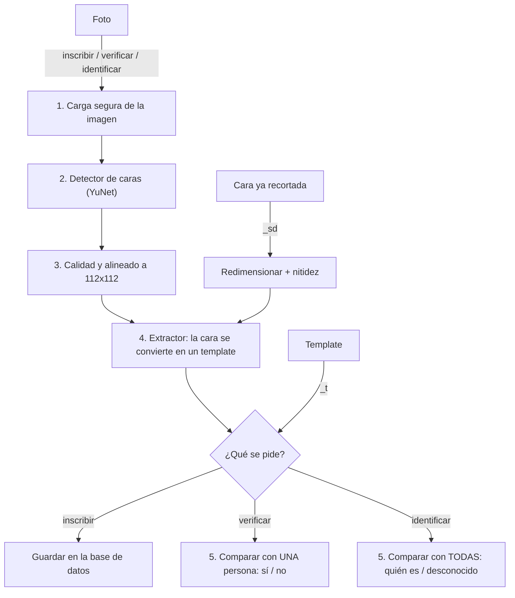

# JumeXBiometrics

Sistema de **reconocimiento facial** en Python para la práctica de *Sistemas
Biométricos* (Grado en Ciberseguridad e IA, Universidad de Málaga). El
enunciado está en [`Prácticas.pdf`](Pra%CC%81cticas.pdf).

Dada una foto, el sistema **encuentra la cara, la convierte en una lista de
números (el *template*) y la compara con las personas guardadas** en una base
de datos `.csv` protegida con firma criptográfica. Con eso permite **inscribir**
personas, **verificar** una identidad (¿es esta foto de Ana?) e **identificar**
a alguien (¿de quién es esta foto?). Se maneja desde la línea de comandos, desde
Python o desde una web, **JumeX Lens**.


> **Estado:** las fases 1 a 5 del proyecto (detector, extractores, base de
> datos, los 9 métodos y la CLI) y la demo web están terminadas y probadas
> (175 tests). **Faltan** la evaluación formal del sistema y el modelo de
> amenazas (fases 6 y 7), y **todavía no está asignada la técnica de
> reconocimiento definitiva**: mientras tanto hay dos extractores
> intercambiables, uno provisional (LBP) y uno de referencia (SFace). Los
> detalles, sin maquillar, están en [Estado del proyecto](#estado-del-proyecto-y-trabajo-pendiente).

## Índice

- [Qué ofrece](#qué-ofrece)
- [Puesta en marcha](#puesta-en-marcha)
- [Cómo funciona por dentro](#cómo-funciona-por-dentro)
  - [Visión general](#visión-general)
  - [Paso 1: cargar la imagen](#paso-1-cargar-la-imagen)
  - [Paso 2: encontrar la cara](#paso-2-encontrar-la-cara)
  - [Paso 3: control de calidad y alineado](#paso-3-control-de-calidad-y-alineado)
  - [Paso 4: convertir la cara en un template](#paso-4-convertir-la-cara-en-un-template)
  - [Paso 5: comparar](#paso-5-comparar)
  - [La base de datos](#la-base-de-datos)
  - [Inscribir, verificar e identificar](#inscribir-verificar-e-identificar)
  - [Las variantes sd y t](#las-variantes-sd-y-t)
- [Los modelos que utiliza](#los-modelos-que-utiliza)
- [Cuánto acierta](#cuánto-acierta)
- [Uso](#uso)
  - [Línea de comandos](#línea-de-comandos)
  - [Desde Python](#desde-python)
  - [Scripts y herramientas](#scripts-y-herramientas)
- [JumeX Lens (la web)](#jumex-lens-la-web)
- [Configuración](#configuración)
- [Seguridad](#seguridad)
- [Estructura del repositorio](#estructura-del-repositorio)
- [Tests](#tests)
- [Estado del proyecto y trabajo pendiente](#estado-del-proyecto-y-trabajo-pendiente)
- [Decisiones de diseño](#decisiones-de-diseño)
- [Problemas frecuentes](#problemas-frecuentes)
- [Glosario](#glosario)
- [Referencias](#referencias)

---

## Qué ofrece

El sistema responde a tres preguntas:

| Operación | Pregunta | Resultado |
|---|---|---|
| **Inscribir** | "Esta es Ana: guárdala." | Añade una muestra de Ana a la base de datos |
| **Verificar** (1:1) | "¿Es esta foto de Ana?" | Sí o no, con una puntuación |
| **Identificar** (1:N) | "¿De quién es esta foto?" | Un nombre, o "desconocido" |

Y lo hace de tres formas, según lo que se le dé:

| Entrada | Métodos | Qué se salta |
|---|---|---|
| Una **foto** | `inscribir`, `verificar`, `identificar` | Nada: pipeline completo |
| Una **cara ya recortada** | `inscribir_sd`, `verificar_sd`, `identificar_sd` | El detector (*sin detector*) |
| Un **template** | `inscribir_t`, `verificar_t`, `identificar_t` | El detector y el extractor |

Son los **9 métodos que pide el enunciado**. Además:

- **Línea de comandos** con salida JSON (también dentro de Docker): pensada para que el grupo rival pueda ejecutar y atacar el sistema.
- **API en Python** (`SistemaBiometrico`).
- **Dos extractores intercambiables** con una línea de configuración: LBP (clásico, provisional) y SFace (red neuronal, de referencia).
- **Base de datos en CSV** con firma HMAC por fila, cifrado opcional de los templates y escritura atómica.
- **JumeX Lens**: web para verificar, identificar (incluso a varias personas en una foto), inscribir y editar la base de datos, con la animación de cada paso del pipeline.
- **Demo de cámara** en directo y varios scripts para revisar el detector y comparar caras.
- **Dockerfile** y **175 tests**.

---

## Puesta en marcha

### En local (lo más cómodo)

Requisitos: **Python 3.11 o superior** (el Docker usa 3.11; se ha desarrollado con 3.14).

```bash
python3 -m venv .venv && source .venv/bin/activate   # en Windows: .venv\Scripts\activate
pip install -r requirements-dev.txt
python scripts/descargar_modelos.py                   # baja los modelos y verifica su SHA256
python -m biometria                                   # comprueba que todo está en su sitio
pytest -q                                             # 175 tests
```

> Si el repo está en OneDrive o Dropbox, crea el entorno virtual **fuera** de la
> carpeta sincronizada (`python3 -m venv ~/.venvs/jumex`) para evitar conflictos.

### Con Docker

```bash
docker build -t jumex-biometrics .
docker run --rm -v "$(pwd)/data:/app/data" jumex-biometrics                # estado del entorno
docker run --rm -v "$(pwd)/data:/app/data" jumex-biometrics inscribir --id "Ana López" --foto data/fotos/ana.jpg
docker run --rm --entrypoint python jumex-biometrics -m pytest -q          # tests dentro del contenedor
```

`data/` se monta como volumen: ahí viven `bd.csv`, la clave y las fotos (que
deben estar dentro de `data/` para que el contenedor las vea). Los modelos se
descargan y se verifican durante el *build*, no están en el repositorio.
Límites: **la web no funciona en Docker** (solo escucha en `127.0.0.1` dentro del
contenedor) y la cámara tampoco se ve desde Docker en macOS. *El Dockerfile se
escribió con cuidado pero no se ha podido construir en la máquina de desarrollo
(no tenía Docker instalado): conviene probarlo.*

### Probarlo en 5 minutos

```bash
# 1) Un conjunto de caras reales para probar: 50 personas de LFW
python scripts/preparar_lfw.py                              # data/lfw/fotos/*.jpg y data/lfw/personas.csv

# 2) Inscribirlas con el extractor SFace en una base de datos propia (data/lens/)
python scripts/inscribir_csv.py data/lfw/personas.csv --config config_lens.yaml

# 3) Abrir la web
python -m biometria.web                                     # http://127.0.0.1:8000
```

O sin web, por línea de comandos:

```bash
python -m biometria --config config_lens.yaml identificar --foto data/lfw/fotos/Jack_Straw.jpg
```

---

## Cómo funciona por dentro

### Visión general

Todo el sistema gira en torno a una idea: **comparar números, no fotos**.
Una foto se transforma en un **template** (un vector de números que resume los
rasgos de la cara). Lo único que se guarda en la base de datos son templates,
nunca fotos, y reconocer a alguien consiste en comparar el template de la foto
nueva con los guardados.



**Ejemplo real de lo que ocurre al verificar** (una foto de 250×250 píxeles,
extractor SFace, umbral 68 %):

| Paso | Qué pasa | Resultado |
|---|---|---|
| Carga | Se valida el fichero y se decodifica | imagen 250×250 |
| Detección | YuNet busca caras | 1 cara, confianza 92 % |
| Calidad y alineado | Se comprueba tamaño y nitidez; se gira y recorta | cara de 112×112, nitidez 128 ✓ |
| Extractor | SFace convierte la cara en números | template de 128 valores |
| Comparación | Se compara con los templates guardados de "Jack Straw" | similitud 85 % |
| Decisión | 85 % ≥ 68 % (umbral) | **aceptado** |

### Paso 1: cargar la imagen

Toda imagen que entra al sistema (desde un fichero, desde bytes recibidos por
red o desde un array de numpy) pasa por **un único punto**,
`biometria/imagen.py`, que aplica los mismos límites siempre:

- Tamaño del fichero: máximo **10 MiB** (`limites.max_bytes_imagen`).
- Tamaño en píxeles: máximo **25 Mpx** (`limites.max_pixeles`). Además OpenCV
  rechaza por sí mismo, antes de decodificar, lo que supere los **50 Mpx**: es la
  defensa contra las "bombas de descompresión" (un PNG de pocos KB que ocupa
  gigabytes al abrirse).
- Lado mínimo de **16 px**.
- La orientación EXIF se aplica (las fotos de móvil giradas se enderezan).
- El resultado siempre es una imagen **BGR de 8 bits** (el formato de OpenCV).

Si algo falla, se lanza un error con código estable (`imagen_invalida`,
`imagen_demasiado_grande`) y el sistema no sigue.

### Paso 2: encontrar la cara

El detector es **YuNet** (red neuronal pequeña incluida en OpenCV,
`cv2.FaceDetectorYN`). Para cada cara devuelve su recuadro, **5 puntos clave**
(ojo izquierdo, ojo derecho, punta de la nariz y las dos comisuras de la boca) y
una **confianza** entre 0 y 1. Se aceptan las caras con confianza ≥ **0,8**.

Detalles que importan:

- **Detección multiescala.** YuNet pierde las caras que ocupan más de un ~40 %
  del ancho de la imagen (un retrato de primer plano). Por eso la imagen se
  analiza a tres tamaños (lado mayor de 1280, 640 y 320 px) y los resultados se
  fusionan: si dos detecciones se solapan más de un 40 % (IoU), son la misma cara
  y se queda la de mayor confianza. Las coordenadas siempre se devuelven en la
  imagen original, y la cara se recorta de la original a resolución completa.
- **Varias caras en la foto.** Según `detector.varias_caras`: `error` (por
  defecto en `config.yaml`) rechaza la foto con el error `varias_caras`, para no
  inscribir o verificar a la persona equivocada; `mayor` se queda con la cara más
  grande. Si no hay ninguna, error `sin_cara`.

### Paso 3: control de calidad y alineado

Antes de extraer nada se comprueba que la cara sirve:

| Control | Cómo se mide | Umbral (`config.yaml`) | Error |
|---|---|---|---|
| **Tamaño** | Lado menor del recuadro, en la imagen original | ≥ 60 px | `cara_pequena` |
| **Nitidez** | *Varianza del Laplaciano* de la cara ya alineada: una cara nítida tiene bordes marcados (valores altos); una borrosa, no | ≥ 50 | `imagen_borrosa` |

Después se **alinea**: con los 5 puntos clave se calcula la transformación
(rotación + escala + traslación) que lleva los ojos, la nariz y la boca a unas
posiciones fijas, y se recorta una cara de **112×112 píxeles**. Así todas las
caras llegan al extractor con los ojos horizontales y a la misma altura,
independientemente de cómo estuviera hecha la foto. Se usa la plantilla estándar
de ArcFace/InsightFace, de modo que el mismo recorte sirve para cualquier
extractor.

### Paso 4: convertir la cara en un template

El **extractor** transforma la cara alineada en un template. Todos cumplen la
misma interfaz (`biometria/extractores/base.py`): `extraer` (cara → template),
`comparar` (dos templates → similitud en [0, 1]) y `validar_template`
(comprueba que unos números recibidos de fuera son un template válido). Gracias
a eso, **cambiar de técnica es añadir un fichero y cambiar una línea de
`config.yaml`**; nada más se toca.

Hay dos extractores:

**LBP** (*Local Binary Patterns*, `extractor.nombre: lbp`) — técnica clásica
basada en la textura de la cara. Provisional.
1. Se pasa la cara a gris.
2. Cada píxel se compara con sus 8 vecinos: los que son más claros o iguales dan
   un 1, los demás un 0. Los 8 resultados forman un número de 8 bits (el
   *código LBP*) que describe la micro-textura de ese punto (borde, esquina,
   zona plana…).
3. Los códigos se agrupan en 59 clases ("patrones uniformes").
4. La cara se divide en una rejilla de 7×7 = 49 celdas y de cada celda se
   calcula un **histograma** de esas 59 clases.
5. Los 49 histogramas, normalizados, se concatenan: **2891 números** (59 × 49).

**SFace** (`extractor.nombre: sface`) — red neuronal de reconocimiento facial de
OpenCV Zoo. Recibe la cara de 112×112 y devuelve **128 números**, normalizados
para que el vector mida 1. Es la referencia fuerte: distingue personas mucho
mejor que LBP (ver [Cuánto acierta](#cuánto-acierta)).

### Paso 5: comparar

Cada extractor sabe medir cuánto se parecen dos templates, y **siempre devuelve
una puntuación entre 0 y 1, donde 1 significa idénticos**. Así los umbrales
significan lo mismo con cualquier técnica.

- LBP: distancia chi-cuadrado entre histogramas, convertida con `1 − χ²/2`.
- SFace: similitud coseno entre los vectores, convertida con `(coseno + 1)/2`.

Si una persona tiene varias muestras guardadas, su puntuación es la **máxima**
entre todas (o la **media**, con `bd.agregacion: media`).

### La base de datos

Los templates se guardan en un **CSV** (`data/bd.csv` por defecto), **una fila
por muestra**; una persona puede tener varias:

```
id,template,hmac
Jack Straw,f32:BS+nOAAAAAAAAAAAAAAAAAUvJzkAAAAA...,4c1f9e07a3...
Jack Straw,f32:AAAgPwAAQD8AAAAAAAAAAAAAAAAAAAAA...,b72e04d19c...
Allyson Felix,f32:AADAPgAAAD8AAAAAAAAAAAAAAAAAAAAA...,51d9aa6e20...
```

| Columna | Contenido |
|---|---|
| `id` | El nombre de la persona (validado y normalizado, ver abajo) |
| `template` | `f32:` + los números del template en base64 (float32 little-endian). Con el cifrado activado: `gcm:` + base64 del template cifrado con AES-256-GCM |
| `hmac` | Firma HMAC-SHA256 de la fila |

**Cómo se protege.** El atacante que puede escribir en el CSV no debería poder
colar a nadie ni borrar a nadie sin que se note:

- **Una firma por fila** que cubre: el `id`, el `template`, **la posición de la
  fila y el número total de filas**. Por eso detecta no solo que se modifique una
  fila, sino también que se **borre, duplique o reordene**, o que se copie el
  template de una persona a otra. Cualquier cambio da el error `integridad_bd`.
- **Se verifica antes de interpretar nada:** cada vez que se usa la base de datos
  se lee el fichero entero y se comprueban todas las firmas *antes* de mirar el
  contenido de las filas. Nunca se vuelve a firmar algo que no pasó la
  verificación, así que una BD manipulada no puede "blanquearse" inscribiendo a
  alguien encima.
- **Escritura atómica:** se escribe en un fichero temporal, se fuerza a disco y se
  renombra. Un fallo a mitad no deja un CSV a medias.
- **La clave** viene de la variable de entorno `BIOMETRIA_HMAC_KEY` (mínimo 32
  caracteres) o, si no existe, del fichero `data/clave_hmac.key`, que se genera
  solo la primera vez que se inscribe a alguien (64 caracteres aleatorios, permisos
  `600`). De esa clave maestra se derivan, con HKDF, **dos claves independientes**:
  una para las firmas y otra para el cifrado. **Si se pierde la clave, la base de
  datos no se puede verificar** y hay que volver a inscribir.
- **Cifrado opcional** (`bd.cifrar_templates: true`): los templates se cifran con
  AES-256-GCM; el `id` va como dato asociado, de modo que un template cifrado no
  se puede mover a otra persona. Es compatible con una BD ya creada (cada fila dice
  con su prefijo `f32:`/`gcm:` cómo leerla).
- **Validación al leer:** cada template se comprueba con su extractor
  (dimensión, valores finitos, rangos). Una BD creada con otro extractor se
  rechaza con un mensaje claro, en vez de dar puntuaciones absurdas.

**Los identificadores.** Deben empezar por una letra o un número y solo pueden
contener letras (con acentos y ñ), números, espacios y `. - _ '`, hasta 100
caracteres. Empezar por letra o número evita la inyección de fórmulas al abrir el
CSV con Excel (`=`, `+`, `-`, `@`). Se normalizan a Unicode NFC, de modo que
"José" escrito de dos formas distintas es la misma persona.

**Otros límites:** como máximo **10 muestras por persona**
(`limites.max_muestras_por_id`).

**Operaciones disponibles** (`biometria/bd.py`): inscribir una muestra, consultar,
eliminar una persona, eliminar una muestra concreta y cambiar el nombre de una
persona. Cada muestra tiene una *clave estable* (los 16 primeros caracteres del
SHA-256 de su campo `template`), sin necesidad de otra columna; la web la usa
para asociar a cada muestra su foto.

**Qué NO detecta la integridad** (se documentará en el modelo de amenazas):
- **Volver a una copia antigua completa y válida** del CSV (*rollback*): sigue
  teniendo firmas correctas.
- **Borrar el fichero entero**: equivale a una base de datos vacía. Es una
  denegación de servicio, pero no permite suplantar a nadie.
- Quien tenga la **clave** puede firmar lo que quiera.
- Con el cifrado desactivado (el valor por defecto), **quien pueda leer el CSV ve
  los templates**. Y con el cifrado activado pero la clave en el mismo equipo
  (`data/clave_hmac.key`), la protección es limitada; es mejor pasar la clave por
  la variable de entorno.

### Inscribir, verificar e identificar

**Inscribir** (`id`, foto):
1. Se valida el `id`.
2. La foto pasa por el pipeline (pasos 1 a 4) y da un template.
3. Se añade como una **nueva muestra** de esa persona (se crea si es nueva), si no
   se supera el máximo de muestras.

El sistema **no comprueba que la cara no esté ya inscrita con otro nombre** (ver
[limitaciones](#estado-del-proyecto-y-trabajo-pendiente)).

**Verificar** (`id`, foto) — 1:1:
1. Se comprueba que `id` está inscrito (antes de procesar la foto: un `id`
   inexistente responde rápido y con un error claro).
2. La foto da un template.
3. Se compara con las muestras de esa persona y se calcula su puntuación (máximo o
   media).
4. **Aceptado si la puntuación ≥ `umbrales.verificacion`**. Siempre se devuelve la
   puntuación, también cuando se rechaza.

**Identificar** (foto) — 1:N:
1. La foto da un template.
2. Se compara con **todas** las personas de la base de datos.
3. Se toma la de mayor puntuación (con empate, la primera alfabéticamente, para que
   el resultado sea determinista).
4. Si esa puntuación ≥ `umbrales.identificacion`, se devuelve esa persona; si no,
   **desconocido** (`id: null`). En ambos casos se informa de la mejor puntuación.

> El umbral de identificación suele ser algo más exigente que el de
> verificación: en 1:N se compara con todas las personas, así que cuantas más
> hay, más probable es una coincidencia falsa por casualidad.

### Las variantes sd y t

Existen porque el enunciado pide evaluar qué ocurre si **un atacante se salta
alguna parte del sistema**.

| Variante | Qué recibe | Qué hace | Qué se salta |
|---|---|---|---|
| `_sd` (*sin detector*) | Una foto que **ya es una cara recortada** | La redimensiona a 112×112 (**sin alinear**: no hay puntos clave), comprueba la nitidez y extrae el template | Detector y alineado |
| `_t` | Un **template** | Lo valida con el extractor (dimensión, valores finitos, rangos) y lo usa directamente | Detector y extractor (ni siquiera carga el modelo YuNet) |

Una decisión de interpretación: el enunciado dice que `verificar_t` e
`identificar_t` reciben "una foto", pero también que omiten el extractor, así que
se interpreta como una errata y reciben un **template**.

---

## Los modelos que utiliza

| Modelo | Para qué | Tamaño | Origen y licencia |
|---|---|---|---|
| **YuNet** `face_detection_yunet_2023mar.onnx` | Detectar caras y sus 5 puntos | 228 KB | [OpenCV Zoo](https://github.com/opencv/opencv_zoo/tree/main/models/face_detection_yunet) · MIT |
| **SFace** `face_recognition_sface_2021dec.onnx` | Extractor de referencia (128 números) | 37 MB | [OpenCV Zoo](https://github.com/opencv/opencv_zoo/tree/main/models/face_recognition_sface) · Apache 2.0 |
| **LBP** | Extractor provisional (2891 números) | — (algoritmo, implementado en `biometria/extractores/lbp.py` con numpy) | Ahonen et al., 2006 |

- Los modelos **no están en el repositorio** (están en el `.gitignore`):
  `python scripts/descargar_modelos.py` los descarga a `models/` y **verifica su
  SHA256**, para que un modelo corrupto o sustituido no entre al sistema. Los hashes
  esperados están en ese script.
- Se usa el detector YuNet y no MTCNN porque viene integrado en OpenCV, pesa
  unos 230 KB, no necesita PyTorch ni TensorFlow y da los 5 puntos clave.
- Los tests usan la foto oficial de la astronauta Eileen Collins (NASA, dominio
  público, distribuida con scikit-image), que se descarga a `tests/.cache/` con
  verificación de hash.
- Para las pruebas con caras reales se usa **LFW** (*Labeled Faces in the Wild*,
  fotos de personas conocidas obtenidas de internet), descargado por
  `scripts/preparar_lfw.py` también con verificación de hash. Las fotos **no se
  suben al repositorio**.

---

## Cuánto acierta

Para entender los números:

- **FAR** (*False Accept Rate*): proporción de impostores a los que el sistema
  acepta por error. **FRR** (*False Reject Rate*): proporción de personas
  correctas a las que rechaza por error. Subir el umbral baja el FAR y sube el FRR.
- **EER** (*Equal Error Rate*): el punto en el que ambos coinciden. Cuanto más
  bajo, mejor sistema.
- **Rank-1**: en identificación, qué proporción de veces acierta la persona
  correcta como primera opción.

Medido con **144 personas de LFW con dos fotos cada una** (`varias_caras: mayor`):

| | LBP (provisional) | SFace (referencia) |
|---|---|---|
| Similitud media, misma persona | 0,70 | 0,83 |
| Similitud media, personas distintas | 0,68 | 0,54 |
| **EER** | ≈ 37 % | **≈ 1,4 %** |
| **Rank-1** (identificar entre 144) | 11 % (azar: 0,7 %) | **98,6 %** |

Con SFace, según el umbral elegido:

| Umbral | FAR | FRR |
|---|---|---|
| 0,64 | 1,63 % | 1,39 % |
| 0,66 | 0,47 % | 1,39 % |
| **0,68** (verificación en JumeX Lens) | **0,05 %** | **2,08 %** |
| **0,70** (identificación en JumeX Lens) | **0,01 %** | **3,47 %** |

**Cómo leer estos resultados, con honestidad:**
- **LBP distingue poco**: personas distintas puntúan casi igual que la misma
  persona. Cambiar su radio, vecinos o rejilla apenas lo mejora (EER entre 37 y
  39 %). Con el umbral de `config.yaml` (0,5) aceptaría a cualquiera (FAR 100 %): **ese
  umbral está sin calibrar**.
- Las cifras salen de **scripts puntuales que no están en el repositorio**;
  la evaluación reproducible (con FAR/FRR/EER, curvas DET/ROC y CMC) es la fase 6.
- El umbral de SFace se eligió **sobre los mismos datos** con los que se mide, así
  que las cifras son algo optimistas. Con las 50 fotos del profesor pueden variar.
- LFW son fotos de internet con mucha variación de pose y luz, y solo dos por
  persona.

---

## Uso

### Línea de comandos

```
python -m biometria [--config FICHERO] <comando> [opciones]
```

| Comando | Qué hace |
|---|---|
| `inscribir --id ID --foto F` | Inscribe una muestra (pipeline completo) |
| `verificar --id ID --foto F` | 1:1: ¿es ID la persona de la foto? |
| `identificar --foto F` | 1:N: ¿quién es? (`null` si nadie supera el umbral) |
| `inscribir_sd` / `verificar_sd` / `identificar_sd` | Igual, con una **cara ya recortada** (sin detector) |
| `inscribir_t --id ID --template T` / `verificar_t` / `identificar_t --template T` | Con un **template** (sin detector ni extractor) |
| `extraer --foto F --salida T [--sin-detector]` | Guarda el template de una foto, para usarlo con los `_t` |
| `bd` | Verifica la integridad de la base de datos y lista a los inscritos |
| `estado` (o sin comando) | Versiones y estado del entorno |

Cada comando imprime **una línea JSON** y devuelve un código de salida: `0` si la
operación se ha ejecutado (una verificación rechazada también da 0: mira
`aceptado`), `1` si hay un error controlado y `2` si faltan argumentos. Salidas
reales (extractor SFace):

```bash
python -m biometria --config config_lens.yaml verificar --id "Jack Straw" --foto data/lfw/pruebas/inscritos/Jack_Straw_0002.jpg
# {"operacion": "verificar", "id": "Jack Straw", "aceptado": true, "puntuacion": 0.8458, "umbral": 0.68}

python -m biometria --config config_lens.yaml verificar --id "Jack Straw" --foto data/lfw/pruebas/inscritos/Marc_Grossman_0002.jpg
# {"operacion": "verificar", "id": "Jack Straw", "aceptado": false, "puntuacion": 0.5859, "umbral": 0.68}

python -m biometria --config config_lens.yaml identificar --foto data/lfw/pruebas/inscritos/Allyson_Felix_0003.jpg
# {"operacion": "identificar", "identificado": true, "id": "Allyson Felix", "puntuacion": 0.7913, "umbral": 0.7}

python -m biometria --config config_lens.yaml identificar --foto data/lfw/pruebas/desconocidos/Colin_Powell_0002.jpg
# {"operacion": "identificar", "identificado": false, "id": null, "puntuacion": 0.6356, "umbral": 0.7}

python -m biometria --config config_lens.yaml verificar --id "Nadie" --foto data/fotos/ana.jpg
# {"error": "id_no_inscrito", "mensaje": "'Nadie' no está inscrito"}      (código de salida 1)

python -m biometria inscribir --id "Ana López" --foto data/fotos/ana.jpg
# {"operacion": "inscribir", "id": "Ana López", "muestras": 1}

python -m biometria extraer --foto data/fotos/ana.jpg --salida ana.npy
python -m biometria verificar_t --id "Ana López" --template ana.npy
```

Los **templates** de `--template` y `--salida` pueden ser `.npy` (float32; nunca
se cargan objetos con pickle), `.json` (lista de números) o un texto con el
formato de la base de datos (`f32:` + base64).

**Códigos de error** (siempre en `{"error": código, "mensaje": ...}`):

| Código | Significado |
|---|---|
| `imagen_invalida` | No existe, no es una imagen o está corrupta |
| `imagen_demasiado_grande` | Supera el límite de bytes o de píxeles |
| `sin_cara` | No se detectó ninguna cara |
| `varias_caras` | Hay más de una cara y `varias_caras: error` |
| `cara_pequena` | La cara mide menos de `tam_min_cara` píxeles |
| `imagen_borrosa` | La nitidez no llega a `umbral_borrosidad` |
| `template_invalido` | Dimensión, tipo o valores no válidos para el extractor |
| `id_invalido` | El nombre no cumple las reglas |
| `id_no_inscrito` | Esa persona no está en la base de datos |
| `muestra_no_encontrada` | Esa muestra no existe |
| `limite_muestras` | La persona ya tiene el máximo de muestras |
| `bd_corrupta` | El CSV no tiene el formato esperado |
| `integridad_bd` | Una firma HMAC no cuadra: el CSV fue modificado fuera del sistema |
| `configuracion_invalida` | Valor fuera de rango o falta un fichero |

### Desde Python

```python
from biometria.sistema import SistemaBiometrico

sistema = SistemaBiometrico()                        # o SistemaBiometrico(cargar_config("otra.yaml"))
sistema.inscribir("Ana López", "data/fotos/ana.jpg") # la foto: ruta, bytes o array BGR de numpy
sistema.verificar("Ana López", "data/fotos/ana_2.jpg")
# ResultadoVerificacion(id='Ana López', aceptado=True, puntuacion=0.81, umbral=0.5)
sistema.identificar("data/fotos/quien.jpg")
# ResultadoIdentificacion(id='Ana López', puntuacion=0.81, umbral=0.5)

t = sistema.extraer("data/fotos/ana.jpg")            # el template (numpy float32)
sistema.verificar_t("Ana López", t)
sistema.ranking(t, 3)                                # las 3 personas más parecidas: [(id, puntuación), ...]
```

Los módulos sueltos también se pueden usar: `Detector` (`detectar`, `procesar`),
`crear_extractor` (`extraer`, `comparar`, `validar_template`) y `BaseDatos`
(`inscribir`, `templates_de`, `por_id`, `eliminar`, `eliminar_muestra`, `renombrar`).

### Scripts y herramientas

| Comando | Para qué sirve |
|---|---|
| `python scripts/descargar_modelos.py [--forzar]` | Descarga YuNet y SFace a `models/` y verifica su SHA256 |
| `python scripts/preparar_lfw.py [--personas N] [--semilla S]` | Saca N personas de LFW a `data/lfw/` (fotos y `personas.csv` con `id,foto`) |
| `python scripts/inscribir_csv.py FICHERO.csv [--config C]` | Inscribe en bloque a las personas de un CSV `id,foto` (y guarda su foto para la web) |
| `python scripts/probar_detector.py CARPETA [--anotadas] [--recursivo] [--salida S]` | Pasa el detector por una carpeta y guarda las caras recortadas, las fotos anotadas y un `resumen.csv` (confianza, tamaño, nitidez) para calibrar la calidad |
| `python scripts/comparar_caras.py FOTO1 FOTO2 ...` | Muestra la similitud entre las caras de varias fotos (una puntuación o una matriz) |
| `python -m biometria.camara [--umbral U]` | Detección en directo con la webcam: caras, confianza, puntos, resultado de la calidad y la cara alineada; con `s` guarda la foto, con `q` sale |
| `python -m biometria.web [--tunel]` | Arranca JumeX Lens (ver siguiente apartado) |

---

## JumeX Lens (la web)

Interfaz para **ver el sistema funcionando**: se suelta una foto y se enseña cada
paso del pipeline, con animación de detección y de escaneo. Usa
[`config_lens.yaml`](config_lens.yaml): extractor **SFace**, una base de datos
propia en `data/lens/` y umbrales 0,68 (verificación) y 0,70 (identificación).

```bash
python scripts/descargar_modelos.py
python scripts/inscribir_csv.py data/lfw/personas.csv --config config_lens.yaml   # cargar 50 personas (la primera vez)
python -m biometria.web                                                          # http://127.0.0.1:8000
```

**Qué se puede hacer** (cuatro pestañas):

| Pestaña | Qué hace |
|---|---|
| **Verificar** | Eliges una persona (con sugerencias) y sueltas una foto: responde "Sí, es X" / "No, no es X" con las dos caras lado a lado, una barra de similitud con el umbral marcado y la explicación |
| **Identificar** | Responde "Esta persona es X" o "No está en la base de datos", con las 3 más parecidas. **Si la foto tiene varias personas, comprueba cada cara por separado** (hasta 12) y dice quién es cada una o que no la tiene guardada; las desconocidas tienen un botón "Inscribirla" |
| **Inscribir** | Escribes el nombre y sueltas una foto. Pide confirmación ("¿Es esta la cara de X?") antes de guardar |
| **Base de datos** | Las caras en cuadraditos con el nombre, un buscador y el estado de la integridad. Al pulsar una persona se abre su **ficha** |

**La ficha de una persona** permite ver todas sus fotos (una por muestra),
añadir otra, borrar una concreta, elegir la foto principal, cambiar el nombre o
eliminar a la persona.

**Si el detector no encuentra la cara o elige otra**, se puede **marcar a mano**:
arrastrando un recuadro sobre la foto o pulsando una de las caras detectadas. Se
vuelve a buscar la cara dentro del recuadro para alinearla con sus 5 puntos; si ni
así aparece, se usa el recuadro sin alinear y se avisa de que la comparación será
menos fiable.

**Las fotos de la galería** se guardan solo para mostrarlas
(`data/lens/caras/<persona>/<muestra>.jpg`): el sistema compara **siempre
templates**, nunca estas fotos. Los nombres de fichero son hashes, nunca texto
escrito por el usuario.

### API HTTP

El servidor (solo librería estándar de Python) expone una API JSON. Las fotos se
envían como **cuerpo binario** de la petición.

| Método y ruta | Qué hace |
|---|---|
| `GET /api/estado` | Extractor, umbrales, nº de personas e integridad de la BD |
| `GET /api/personas` | Lista de personas: `{id, muestras, foto}` |
| `GET /api/persona?id=` | Ficha: las muestras de una persona con su foto |
| `GET /api/caras/<persona>/<muestra>.jpg` | Foto de una muestra |
| `POST /api/analizar` | Solo el pipeline (no toca la BD): detecciones, cara alineada, template |
| `POST /api/verificar?id=` | Verifica contra esa persona |
| `POST /api/identificar` | Identifica (a todas las caras si hay varias) |
| `POST /api/inscribir?id=` | Inscribe una muestra |
| `POST /api/persona/principal?id=&clave=` | Elige la foto principal |
| `POST /api/persona/renombrar?id=&nuevo=` | Cambia el nombre |
| `DELETE /api/personas?id=` | Elimina a una persona |
| `DELETE /api/muestras?id=&clave=` | Elimina una muestra |

Los `POST` con foto admiten `&caja=x,y,ancho,alto` (píxeles de la foto) para marcar
la cara a mano. Las respuestas incluyen cada paso (`detecciones`, `cara_alineada`,
`nitidez`, `template`, `tiempos_ms`) y el `resultado` o un `error` con el mismo
código que la CLI.

### Seguridad de la web

- Solo escucha en **`127.0.0.1`**.
- Los `POST` y `DELETE` exigen la cabecera **`X-JumeX-Lens: 1`**: obliga al
  navegador a un permiso previo (*preflight*) que nunca se concede, y así otra web
  abierta en el navegador no puede usar la API (CSRF).
- Rechaza peticiones cuyo **`Host`** no sea localhost (*DNS rebinding*).
- El tamaño de la foto se comprueba **antes de leer el cuerpo**; solo se sirven los
  ficheros de la carpeta `static/`; el navegador recibe una *Content-Security-Policy*
  restrictiva.

### Publicarla en internet (Cloudflare Tunnel)

```bash
brew install cloudflared            # una vez
python -m biometria.web --tunel     # escribe la URL https://<algo>.trycloudflare.com
```

El servidor **sigue en tu equipo** y Cloudflare reenvía las visitas: la web solo
está online mientras el comando siga abierto y la URL cambia cada vez que se arranca.
Se acepta además el dominio `trycloudflare.com`. **No tiene contraseña**: cualquiera
con la URL puede ver las caras, inscribir y borrar. No la publiques con fotos de
personas que no hayan dado su permiso.

---

## Configuración

Todo lo ajustable está en [`config.yaml`](config.yaml) (el que usa la CLI por
defecto) y en [`config_lens.yaml`](config_lens.yaml) (el de la web). Se puede usar
otro con `--config FICHERO` o con la variable de entorno `BIOMETRIA_CONFIG`. Las
rutas relativas se resuelven respecto a la carpeta del fichero. Al cargarse, la
configuración se **valida**: un valor fuera de rango da un error claro
(`configuracion_invalida`) en vez de un fallo raro más adelante.

| Sección | Parámetro | Valor en `config.yaml` | Qué controla |
|---|---|---|---|
| `detector` | `modelo` | `models/face_detection_yunet_2023mar.onnx` | Modelo del detector |
| | `umbral_confianza` | 0,8 | Confianza mínima de YuNet para aceptar una cara |
| | `umbral_nms` | 0,3 | Supresión de detecciones solapadas |
| | `varias_caras` | `error` | `error` rechaza la foto; `mayor` usa la cara más grande |
| `preprocesado` | `tam_cara` | `[112, 112]` | Tamaño de la cara alineada ([ancho, alto]) |
| `calidad` | `tam_min_cara` | 60 | Lado mínimo de la cara (px) |
| | `umbral_borrosidad` | 50 | Nitidez mínima (varianza del Laplaciano) |
| `extractor` | `nombre` | `lbp` | `lbp` o `sface` |
| | `parametros` | `radio: 1, puntos: 8, rejilla: [7, 7]` | Parámetros del extractor (SFace: `modelo`). `rejilla` es [columnas, filas] |
| `bd` | `ruta` | `data/bd.csv` | Dónde se guarda la base de datos |
| | `ruta_clave` | `data/clave_hmac.key` | Fichero de la clave (si no hay variable de entorno) |
| | `cifrar_templates` | `false` | Cifrar los templates con AES-GCM |
| | `agregacion` | `max` | `max` o `media` de las muestras de una persona |
| `umbrales` | `verificacion` | 0,5 | Puntuación mínima para aceptar al verificar |
| | `identificacion` | 0,5 | Puntuación mínima para no devolver "desconocido" |
| `limites` | `max_bytes_imagen` | 10 MiB | Tamaño máximo del fichero de imagen |
| | `max_pixeles` | 25 Mpx | Tamaño máximo en píxeles |
| | `max_muestras_por_id` | 10 | Muestras máximas por persona |

`config_lens.yaml` cambia: `extractor: sface`, `bd` en `data/lens/`, `varias_caras:
mayor`, `umbral_borrosidad: 40` (más permisivo con fotos de internet) y los
umbrales 0,68 / 0,70. **Los umbrales de `config.yaml` (0,5) son provisionales** y
están pensados para recalibrarse con las fotos del profesor.

**Variables de entorno:** `BIOMETRIA_CONFIG` (fichero de configuración) y
`BIOMETRIA_HMAC_KEY` (clave de la base de datos; tiene prioridad sobre el fichero).

---

## Seguridad

El enunciado pide que cada grupo evalúe su sistema suponiendo que **un atacante se
salta alguna parte, lee la base de datos o incluso escribe en ella**. Lo que el
sistema hace hoy frente a cada caso:

| Amenaza | Qué hace el sistema |
|---|---|
| **Modifica o manipula `bd.csv`** (cambiar, copiar entre personas, borrar, duplicar o reordenar filas) | Lo detecta: firma HMAC por fila con su posición y el total → `integridad_bd`. No se puede inscribir encima de una BD manipulada |
| **Lee `bd.csv`** | Ve los templates (con el cifrado desactivado). Cifrado AES-256-GCM opcional, pero la clave está por defecto en el mismo equipo |
| **Se salta el detector** (`_sd`) | Se acepta cualquier imagen que pase la nitidez y se redimensione: es una superficie de ataque conocida. Una imagen sin cara se acepta |
| **Se salta el extractor** (`_t`) | El template recibido se valida (dimensión, valores finitos, rangos), lo que filtra basura; **no impide** fabricar un template válido a medida |
| **Imágenes malintencionadas** | Límites de bytes y píxeles (doble), decodificación solo mediante OpenCV, nunca se cargan objetos con pickle |
| **Nombres malintencionados** | Validación estricta de ids (sin saltos de línea, sin fórmulas de Excel, normalizados) |
| **Pruebas repetidas hasta acertar** (*hill-climbing*) | El sistema **devuelve la puntuación** (hace falta para evaluarlo), lo que facilita ir ajustando un template hasta que suba. No hay límite de intentos |
| **Web** | Ver [seguridad de la web](#seguridad-de-la-web) |

Hay aspectos conocidos **sin resolver** (rollback, falta de límite de intentos,
ausencia de detección de vivacidad —una foto de una foto engaña a cualquier
extractor—, la web sin contraseña…). El documento de amenazas formal
(`THREAT_MODEL.md`) **aún no está escrito**: es la fase 7.

---

## Estructura del repositorio

```
├── biometria/                    paquete principal
│   ├── __init__.py               versión y límite duro de píxeles (hay que importarlo antes que cv2)
│   ├── __main__.py               punto de entrada: python -m biometria
│   ├── cli.py                    línea de comandos (salida JSON)
│   ├── sistema.py                SistemaBiometrico: los 9 métodos
│   ├── imagen.py                 carga segura de imágenes (límites de bytes y píxeles)
│   ├── detector.py               YuNet multiescala + calidad + alineado
│   ├── extractores/
│   │   ├── base.py               interfaz común: extraer, comparar, validar_template
│   │   ├── lbp.py                LBP uniforme por rejilla (provisional)
│   │   └── sface.py              SFace de OpenCV Zoo (referencia)
│   ├── bd.py                     base de datos CSV con HMAC, cifrado opcional y edición
│   ├── config.py                 carga y validación de la configuración
│   ├── errores.py                excepciones con código estable
│   ├── camara.py                 demo en directo con la webcam
│   └── web/                      JumeX Lens
│       ├── servidor.py           servidor HTTP y API JSON
│       ├── analisis.py           pipeline paso a paso, varias caras, galería de fotos
│       └── static/               interfaz: index.html, estilos.css, app.js, logo.svg
├── scripts/                      herramientas (ver "Scripts y herramientas")
├── tests/                        175 tests con pytest
├── docs/                         capturas para este README
├── data/                         (fuera de git) fotos, bases de datos, claves
├── models/                       (fuera de git) modelos descargados
├── config.yaml                   configuración por defecto (LBP)
├── config_lens.yaml              configuración de la web (SFace)
├── Dockerfile
└── requirements*.txt             dependencias con versiones fijadas
```

---

## Tests

`pytest -q` ejecuta **175 tests** en menos de 10 segundos. Cubren:

| Fichero | Qué comprueba |
|---|---|
| `test_imagen.py` | Carga segura: formatos, límites, imágenes corruptas |
| `test_config.py` | Validación de la configuración |
| `test_detector.py` | Detección, caras muy grandes, calidad, alineado, imágenes reescaladas |
| `test_extractor.py` | LBP (códigos, patrones uniformes, normalización, comparación, validación de templates) |
| `test_bd.py` | Formato del CSV, **ataques a la integridad** (modificar, copiar, borrar, duplicar, reordenar, clave incorrecta), cifrado, ids, edición |
| `test_sistema.py` | Los 9 métodos, la CLI, los ficheros de template |
| `test_web.py` | SFace, galería de fotos, la API (flujo completo, errores, protecciones, caja manual, varias caras, ficha, edición) |

El LBP se contrastó además con la implementación de referencia de scikit-image
(los códigos coinciden salvo en empates exactos, que aquí cuentan como 1).
Algunos tests necesitan los modelos (`descargar_modelos.py`) y red la primera vez
(para la foto de prueba); si faltan, se saltan con un mensaje.

---

## Estado del proyecto y trabajo pendiente

| Fase | Rama | Contenido | Estado |
|---|---|---|---|
| 1 | `setup-base` | Estructura, dependencias, Docker, configuración | ✅ |
| 2 | `detector` | YuNet, alineado, control de calidad y demo de cámara | ✅ |
| 3 | `extractor` | Interfaz de extractor y LBP provisional | ✅ |
| 4 | `bd-csv` | Base de datos CSV con integridad (HMAC) | ✅ |
| 5 | `sistema-cli` | `SistemaBiometrico` con los 9 métodos y la CLI | ✅ |
| extra | `web`, `web-v2` | SFace, JumeX Lens, varias caras, ficha editable, Cloudflare Tunnel | ✅ |
| 6 | `inscripcion-evaluacion` | Inscripción masiva de las 51 personas; FAR/FRR/EER, curvas DET/ROC y CMC | ⏳ |
| 7 | `seguridad` | `THREAT_MODEL.md` y contramedidas | ⏳ |

**Pendiente:**
- **La técnica de reconocimiento asignada.** Cuando se sepa, se añade como extractor y se cambia en `config.yaml`; el resto del sistema no se toca.
- **Las 50 fotos del profesor** y nuestra persona número 51 (se puede capturar con `python -m biometria.camara`).
- **La evaluación reproducible** (fase 6) y la **calibración de los umbrales** de `config.yaml`.
- **El modelo de amenazas** (fase 7).
- **Probar el Docker** (no se ha construido en la máquina de desarrollo).

**Limitaciones conocidas:**
- No se comprueba al inscribir que la cara **no esté ya inscrita con otro nombre** (ni que una muestra nueva se parezca a las anteriores de esa persona: se pueden inscribir caras distintas bajo el mismo nombre).
- **Sin detección de vivacidad:** una foto de una foto, o una imagen de una pantalla, se trata como una cara real.
- La web no tiene contraseña ni límite de intentos, y no funciona en Docker.
- Las ramas están subidas a GitHub como ramas de trabajo; `main` aún no las incluye.

---

## Decisiones de diseño

Decisiones tomadas donde el enunciado es ambiguo o deja libertad:

**Sobre el enunciado**
1. **`verificar_t` e `identificar_t` reciben un template**, no una foto (errata del enunciado, ver [las variantes](#las-variantes-sd-y-t)).
2. **Los métodos `_sd` asumen una cara ya recortada:** no la alinean (no hay puntos clave), solo la redimensionan; **sí pasan el control de nitidez**, para que una imagen plana o vacía no llegue al extractor.
3. **Comando extra `extraer`:** no lo pide el enunciado, pero sin él no hay forma cómoda de obtener templates para probar los `_t`.

**Detección y preprocesado**
4. **YuNet en vez de MTCNN** (integrado en OpenCV, ligero, sin PyTorch/TensorFlow).
5. **Varias caras:** por defecto se rechaza la foto (`error`) para no inscribir o verificar a la persona equivocada; la web usa `mayor`.
6. **Alineado con los 5 puntos**, no solo con los ojos: es una transformación de similitud (rotación + escala + traslación) estimada con LMEDS, más estable si un punto sale mal.
7. **Calidad medida donde importa:** el tamaño sobre la caja de la imagen original; la nitidez sobre la cara ya alineada, para que no dependa de la resolución de la foto.
8. **Detección multiescala:** YuNet no ve las caras que ocupan más del ~40 % de su entrada, así que se detecta también a 640 y 320 px y se fusiona.
9. **Doble límite de píxeles** (el duro de OpenCV, fijado antes de importar `cv2`, y el configurable): por eso hay que **importar `biometria` antes que `cv2`**.

**Extractores y comparación**
10. **Toda puntuación está en [0, 1] y "más alto = más parecido"**, sea cual sea el extractor.
11. **Los templates que llegan de fuera se validan** siempre (dimensión, valores finitos, rangos), pero eso no impide un template fabricado a medida.
12. **LBP con numpy, sin scikit-image**, para no añadir una dependencia pesada.
13. **Puntuación frente a una persona = máximo entre sus muestras** (o media, configurable).
14. **Se devuelve la puntuación y no solo la decisión**: hace falta para la evaluación (curvas DET/ROC) y para que el rival pueda medir el sistema; a cambio facilita el *hill-climbing*.
15. **Los umbrales se separan por operación**: la identificación es más exigente que la verificación.

**Base de datos**
16. **Un CSV con una fila por muestra** y un prefijo (`f32:`/`gcm:`) que dice cómo leer cada una, para que activar el cifrado no rompa una BD ya creada.
17. **El HMAC de cada fila incluye su posición y el total de filas**, para detectar borrados, duplicados y reordenaciones sin un segundo fichero de firmas. El coste, volver a firmar todo al escribir, es despreciable con unas decenas de personas.
18. **Claves derivadas con HKDF** de una sola clave maestra; en el cifrado, el `id` va como dato asociado.
19. **Verificar antes de interpretar:** las firmas se comprueban antes de mirar el contenido de las filas.
20. **Ids restringidos y normalizados** (sin inyección de fórmulas, Unicode NFC).
21. **Permisos `600`** en `bd.csv` y en la clave.

**Plataforma**
22. **`verificar` comprueba que el id existe antes de procesar la foto**; **los métodos `_t` no cargan el detector**.
23. **Versiones fijadas** (numpy 2.4.x, OpenCV 4.14 **completo**, no *headless*, porque la demo de cámara necesita `cv2.imshow`). Pensadas para Python 3.11 (la imagen de Docker); también funcionan en versiones posteriores.
24. **La web usa SFace y su propia base de datos** (`data/lens/`), para no mezclar templates de extractores distintos con el `data/bd.csv` de la práctica.

---

## Problemas frecuentes

- **`Address already in use` al arrancar la web:** queda un servidor anterior abierto. En macOS el proceso se llama `Python` (con mayúscula): `lsof -nP -iTCP:8000 -sTCP:LISTEN` te dice su PID y `kill <PID>` lo cierra. O arranca en otro puerto con `--puerto 8080`.
- **`CERTIFICATE_VERIFY_FAILED` al descargar modelos en macOS:** el Python de python.org no trae certificados. Ejecuta `/Applications/Python\ 3.11/Install\ Certificates.command` o lanza el script con `SSL_CERT_FILE=/etc/ssl/cert.pem`.
- **`integridad_bd` sin haber tocado nada:** la clave no es la que firmó la BD (se perdió `data/clave_hmac.key`, o `BIOMETRIA_HMAC_KEY` es otra). La BD no se puede recuperar sin su clave: hay que inscribir de nuevo.
- **Un error dice que la BD se creó con otro extractor:** los templates guardados no tienen la dimensión del extractor actual (p. ej. una BD de LBP abierta con `config_lens.yaml`). Usa la configuración con la que se creó, o una BD nueva.
- **La cámara no se abre:** en macOS hay que dar permiso a la terminal o a VS Code en *Ajustes del Sistema → Privacidad y seguridad → Cámara*. Docker en macOS no ve la cámara.
- **La web no abre una foto del iPhone:** las fotos HEIC no están soportadas; expórtala como JPG.
- **No detecta la cara en una foto:** pasa `python scripts/probar_detector.py` sobre la foto para ver qué ve el detector; o, en la web, márcala a mano.
- **`ModuleNotFoundError: cv2` o fallos de límite de píxeles en un script propio:** importa `biometria` antes que `cv2`.

---

## Glosario

| Término | Significado |
|---|---|
| **Template** | Vector de números que resume los rasgos de una cara. Es lo único que se guarda |
| **Extractor** | El componente que convierte una cara en un template (LBP, SFace…) |
| **Muestra** | Un template guardado de una persona. Una persona puede tener varias |
| **Landmarks / puntos clave** | Los 5 puntos de la cara (ojos, nariz, comisuras de la boca) que usa el alineado |
| **Alineado** | Girar y recortar la cara para que los ojos queden horizontales y a la misma altura |
| **Umbral** | Puntuación mínima para dar algo por bueno. Alto = más seguro pero más rechazos |
| **Verificación (1:1)** | Comprobar si una foto es de una persona concreta |
| **Identificación (1:N)** | Averiguar de cuál de todas las personas es una foto |
| **HMAC** | Firma con clave secreta que permite detectar si un dato fue modificado |
| **HKDF** | Forma de derivar varias claves independientes de una sola clave maestra |
| **AES-GCM** | Cifrado que además detecta si el dato cifrado fue alterado |
| **FAR / FRR / EER** | Tasa de falsas aceptaciones / de falsos rechazos / punto donde coinciden |
| **Rank-1** | Proporción de veces que la persona correcta sale como primera opción |
| **IoU** | Cuánto se solapan dos recuadros (intersección dividida por unión) |
| **LBP** | *Local Binary Patterns*: técnica clásica de reconocimiento por textura |
| **LFW** | *Labeled Faces in the Wild*: conjunto público de fotos de caras de personas conocidas |

---

## Referencias

- **YuNet:** Wu, W., Peng, H., Yu, S. *YuNet: A Tiny Millisecond-level Face Detector*. Machine Intelligence Research, 2023. Modelo en [OpenCV Zoo](https://github.com/opencv/opencv_zoo/tree/main/models/face_detection_yunet).
- **SFace:** Zhong, Y., Deng, W., Hu, J., Zhao, D., Li, X., Wen, D. *SFace: Sigmoid-Constrained Hypersphere Loss for Robust Face Recognition*. IEEE Transactions on Image Processing, 2021. Modelo en [OpenCV Zoo](https://github.com/opencv/opencv_zoo/tree/main/models/face_recognition_sface).
- **LBP:** Ahonen, T., Hadid, A., Pietikäinen, M. *Face Description with Local Binary Patterns: Application to Face Recognition*. IEEE TPAMI, 2006.
- **LFW:** Huang, G. B., Ramesh, M., Berg, T., Learned-Miller, E. *Labeled Faces in the Wild*. University of Massachusetts Amherst, Technical Report 07-49, 2007. <https://vis-www.cs.umass.edu/lfw/>
- **Plantilla de alineado:** la de ArcFace/InsightFace para caras de 112×112.
